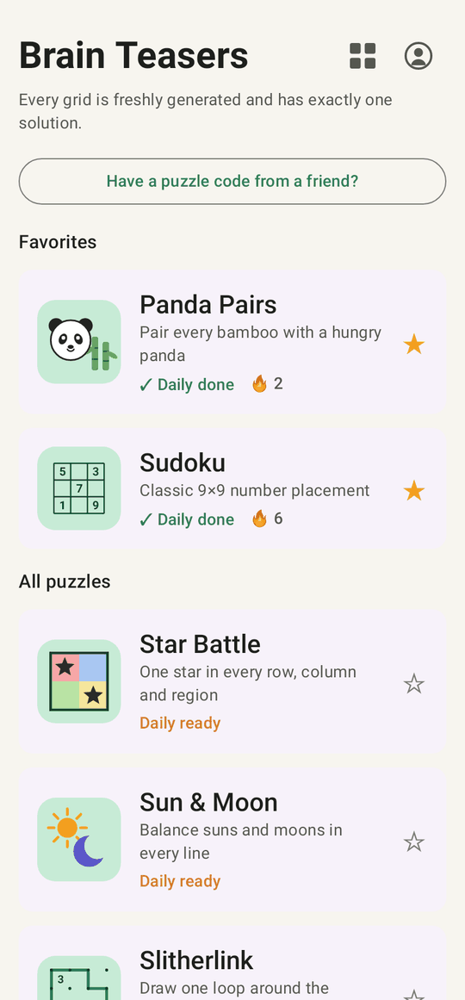
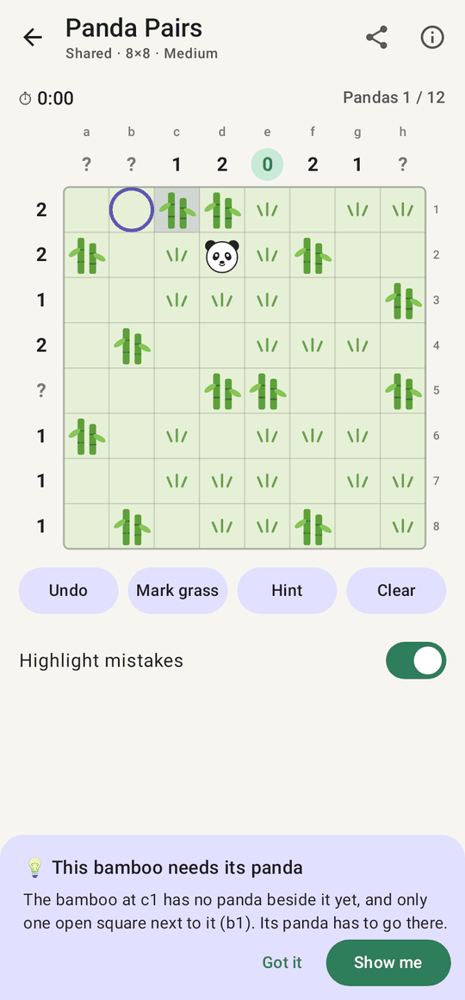
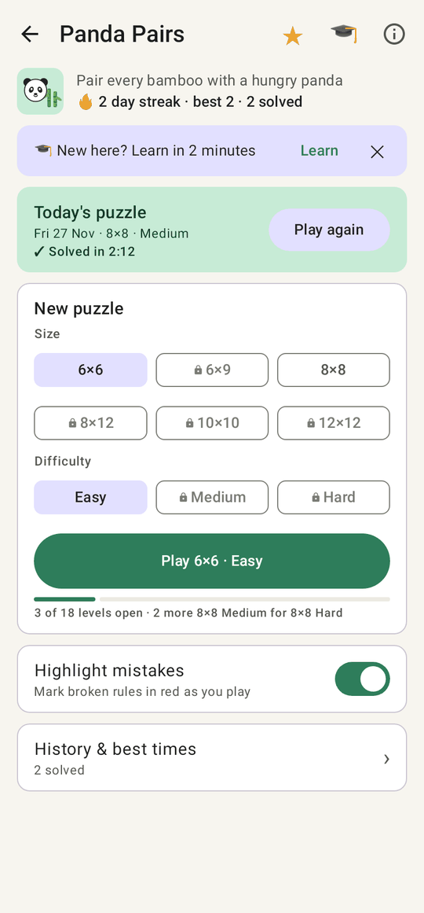

# Brain Teasers

**Logic puzzles for Android, generated on your phone, each with exactly one solution, and hints that teach you how to solve them.**

Panda Pairs, Sudoku, Star Battle, Sun & Moon, Slitherlink, Trail, Minesweeper, Light Up, Link Up,
Bridges, Rectangles, Towers, Islands, Pearls, Pipes, and hexagonal versions of Islands, Minesweeper, Link Up, Trail and Bridges. Every puzzle comes in several board sizes and
difficulties, with a daily puzzle everyone shares, streaks, best times and shareable puzzle codes.

- **[User guide](docs/README.md)**: install, play, hints, daily puzzles, sharing and settings
- **[The puzzles](docs/puzzles/README.md)**: rules, controls and tips for each one
- **[FAQ](docs/faq.md)**

## Download

Get the `.apk` from the **[latest release](https://github.com/eric256/BrainTeasers-releases/releases/latest)**
on your Android phone (Android 8.0 or newer) and open it. Step-by-step directions are in
[Installing and updating](docs/README.md#installing).

## Is the download genuine?

Every release is signed with the same key. Android refuses to install an update signed with a different
key, so updates can only come from the same publisher. You can check a download yourself:

- **Checksum:** each release's notes list the APK's `SHA-256`.
- **Signing certificate (SHA-256):**
  `9A:E6:0A:88:82:DD:A8:48:11:21:FB:72:E9:77:21:95:DF:EE:7D:00:98:83:BE:44:12:74:C7:4E:A6:F6:30:BB`
  (check with `apksigner verify --print-certs BrainTeasers-x.y.z.apk`).

## Privacy

No accounts, ads or analytics. Your history, streaks and settings stay on your phone. The only network
access is checking this page for updates and downloading them.

## Open-source software

Brain Teasers uses open-source libraries under the Apache License 2.0. The full list is in the app:
tap the profile button on the home screen, then **Open-source licenses**.
