# The puzzles

| | Puzzle | |
|---|---|---|
| 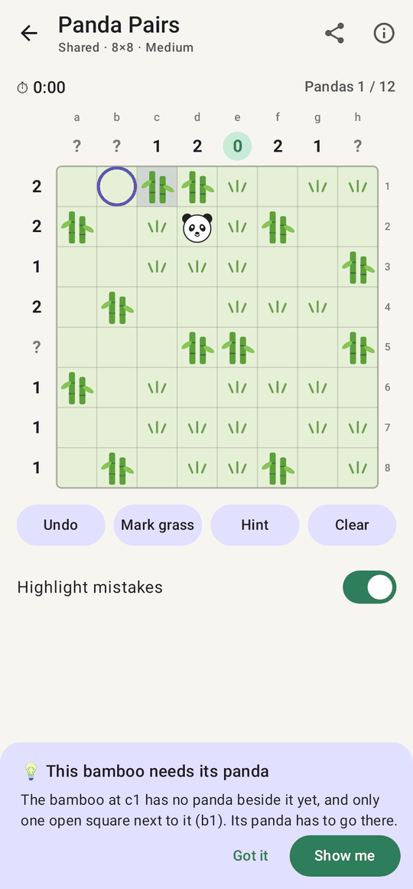 | **[Panda Pairs](panda.md)** | Pair every bamboo with a hungry panda |
| 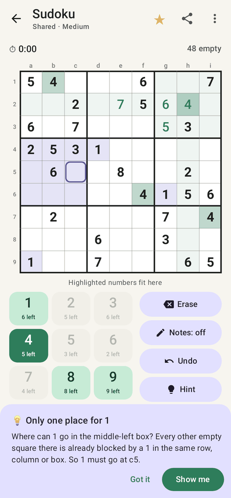 | **[Sudoku](sudoku.md)** | Classic 9×9 number placement |
| 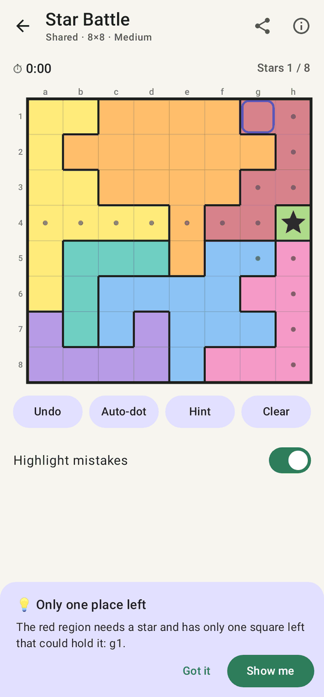 | **[Star Battle](starbattle.md)** | One star in every row, column and region |
| 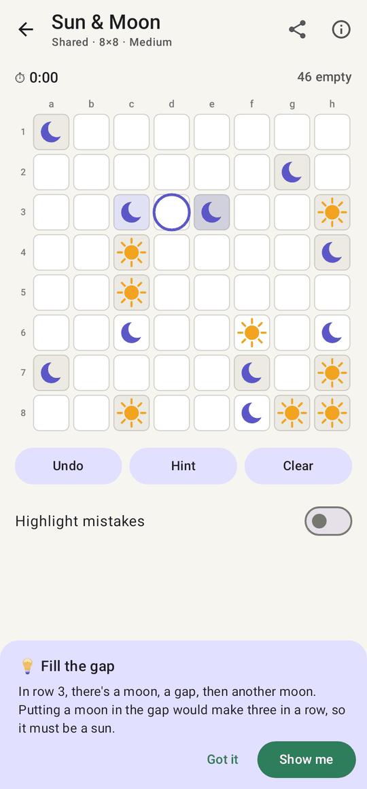 | **[Sun & Moon](sunmoon.md)** | Balance suns and moons in every line |
| 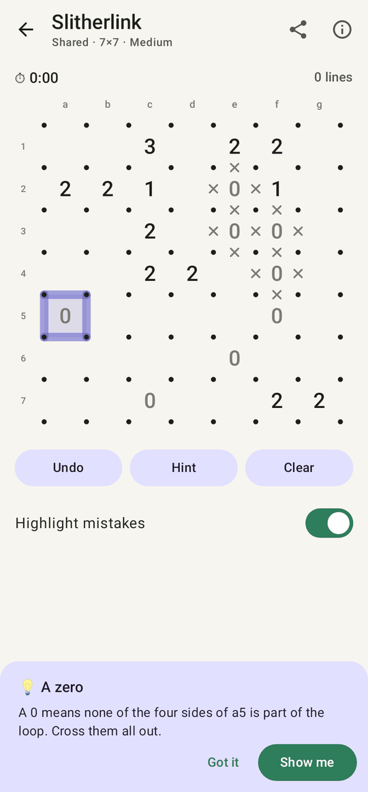 | **[Slitherlink](slitherlink.md)** | Draw one loop around the numbers |
| 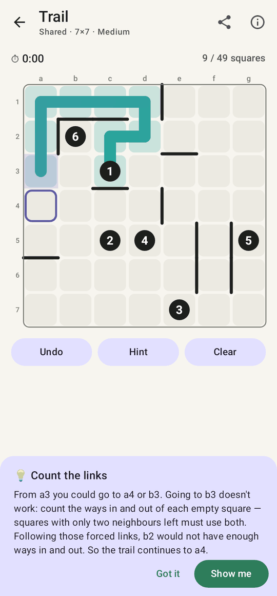 | **[Trail](trail.md)** | One path through every square, in order |
| 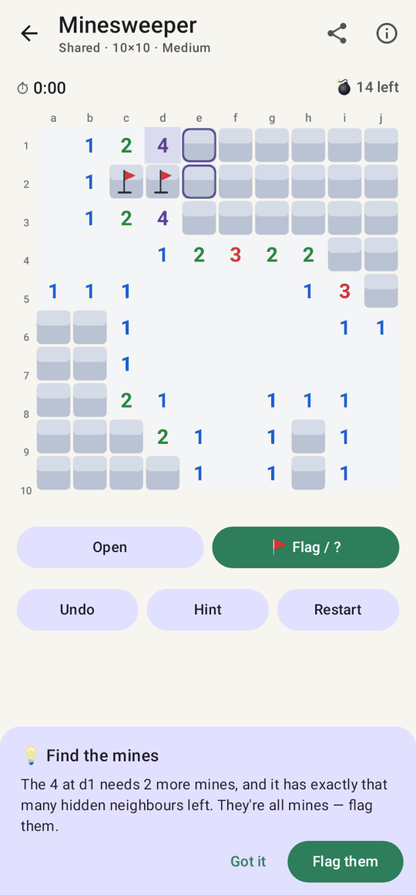 | **[Minesweeper](minesweeper.md)** | Find the mines — no guessing needed |
| 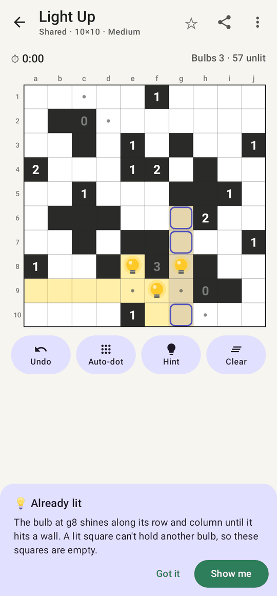 | **[Light Up](lightup.md)** | Light every square without bulbs seeing each other |
| 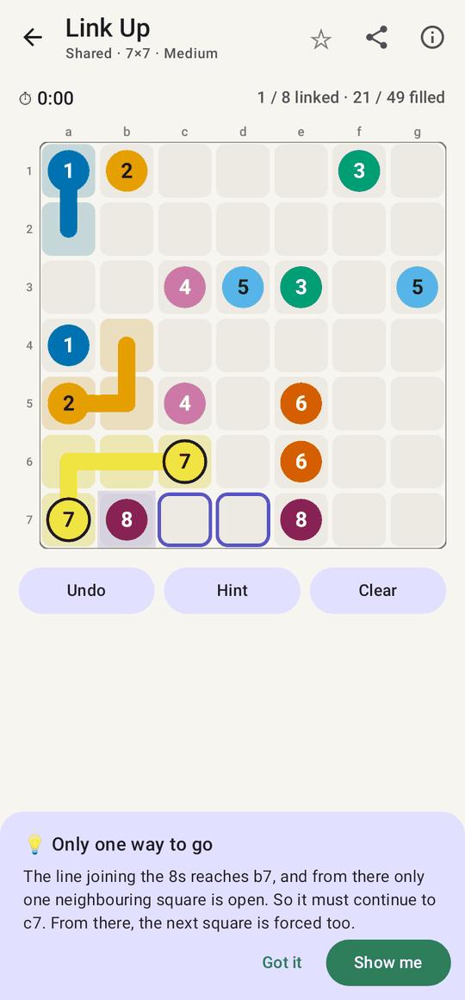 | **[Link Up](linkup.md)** | Join matching numbers and fill every square |
| 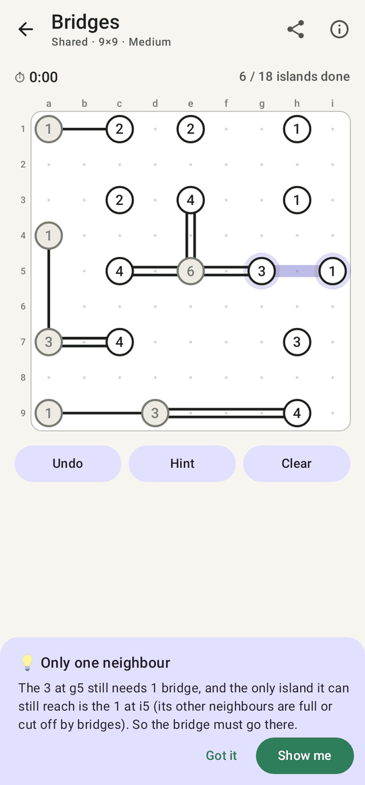 | **[Bridges](bridges.md)** | Connect every island with bridges |
| 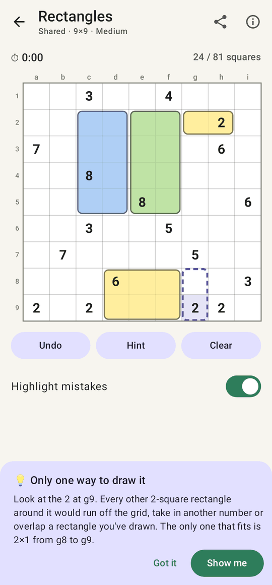 | **[Rectangles](rectangles.md)** | Split the grid into numbered rectangles |
| 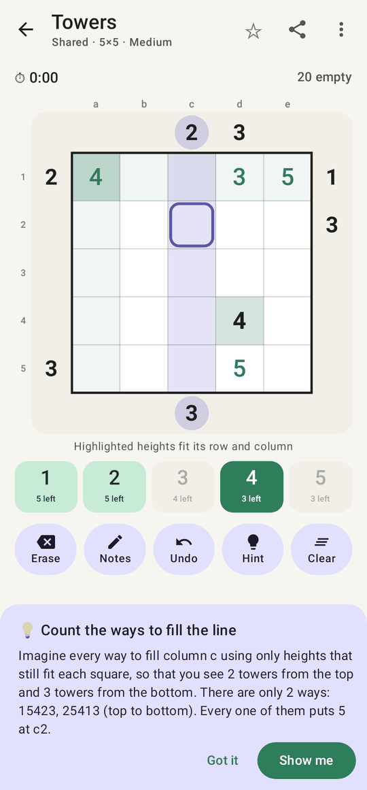 | **[Towers](towers.md)** | Build towers so the edge counts add up |
| 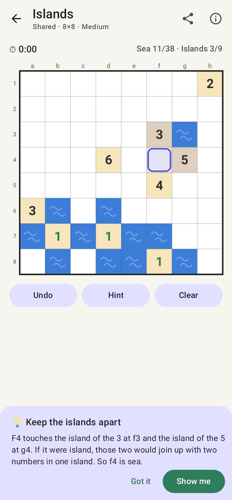 | **[Islands](islands.md)** | Shade the sea around numbered islands |
| 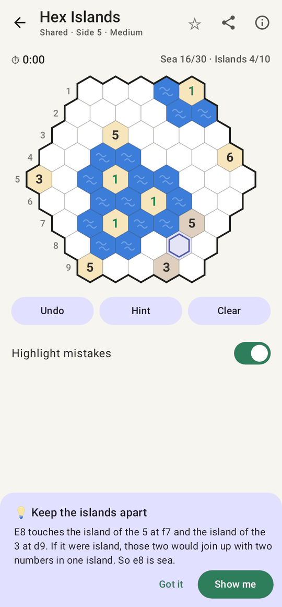 | **[Hex Islands](hexislands.md)** | Islands on a honeycomb of hexagons |
| 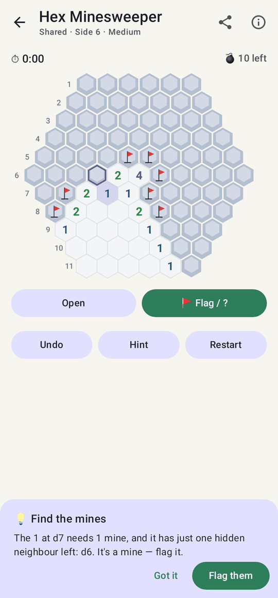 | **[Hex Minesweeper](hexmines.md)** | Find the mines on a honeycomb |
| 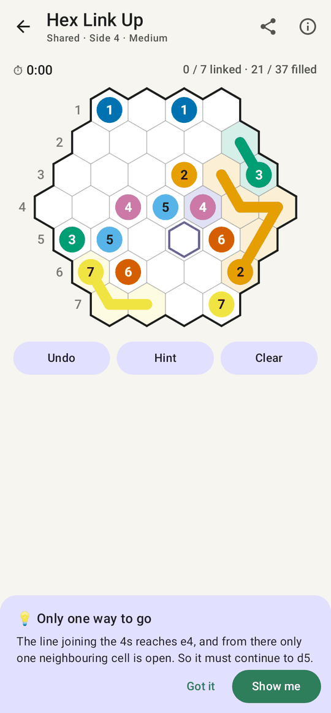 | **[Hex Link Up](hexlinkup.md)** | Join matching numbers across hexes |
| 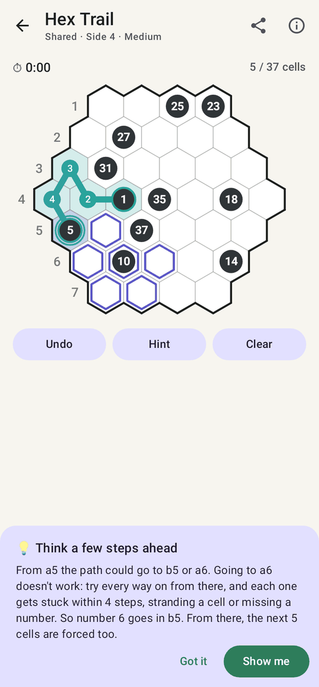 | **[Hex Trail](hextrail.md)** | Number every cell in one winding path |
| 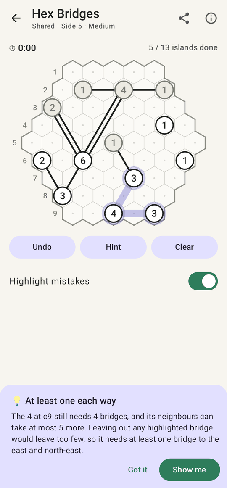 | **[Hex Bridges](hexbridges.md)** | Bridge the islands in six directions |
| 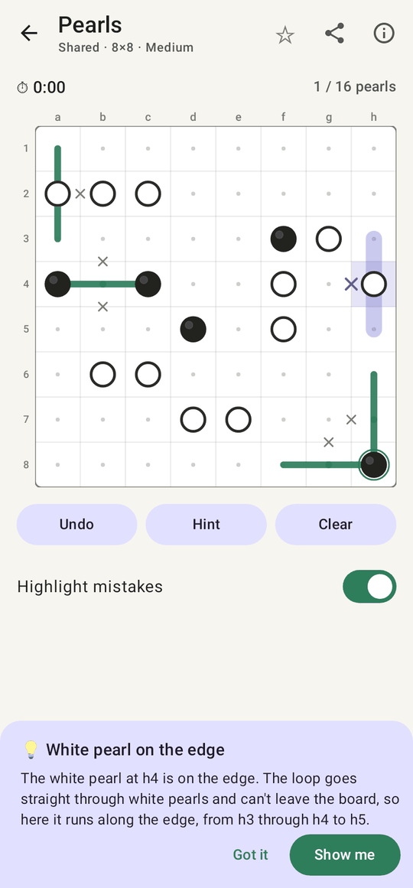 | **[Pearls](pearls.md)** | Draw one loop through every pearl |

[← User guide](../README.md)
