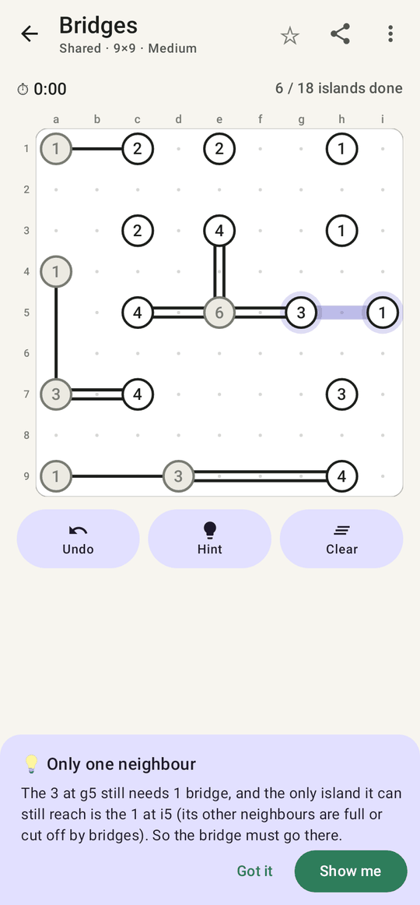
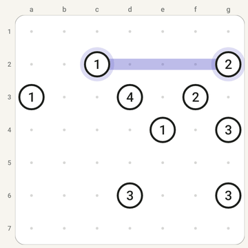
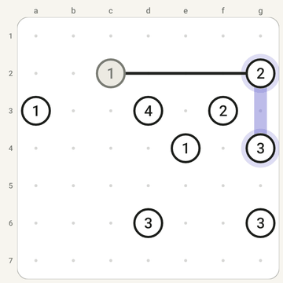
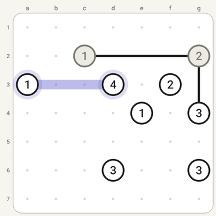
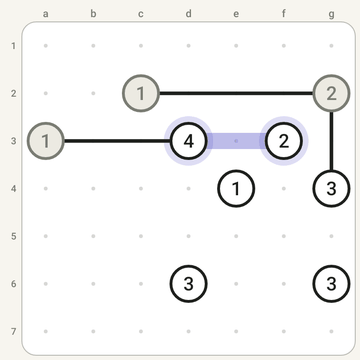
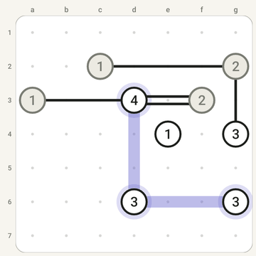
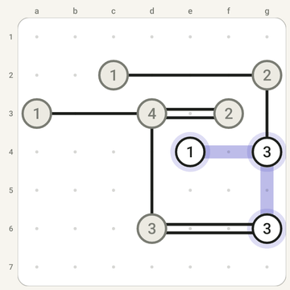
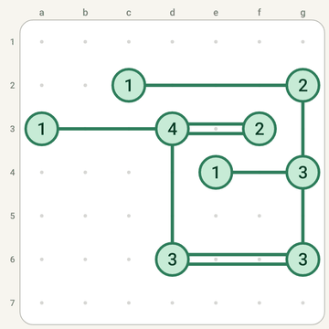

# Bridges

*Connect every island with bridges*

## Rules

- Each circle is an island. Its number says how many bridges connect to it.

- Bridges run straight across or up and down between two islands, never cross other bridges or islands, and at most two join the same pair of islands.

- When you're done, every island must be connected into one group.

Drag from one island toward a neighbouring island to add a bridge; do it again for a double bridge, and once more to remove them. Tapping a bridge also cycles it.

## Sizes and difficulty

Board sizes: 7×7, 9×9, 12×12, 7×10, 9×13. Difficulty: Easy, Medium, Hard. The daily puzzle is small and easy early in the week and bigger and harder at the weekend.

## Learn to play

Tap 🎓 on the Bridges menu for a short tutorial: these pages, then a guided puzzle where a coach shows every step.

**1. The goal.** Connect the islands with bridges. Each island's number is how many bridges touch it. Bridges go straight across or up and down, never cross, at most two join the same pair, and all islands end up connected.

**2. Building bridges.** Drag from an island toward a neighbour to add a bridge; repeat for a double bridge, once more to remove them. An island that needs every possible bridge — like a 4 in a corner — is the place to start. The highlighted bridge is the next step.

**3. Solved!.** Every number is met and all islands are joined. Your turn!

## Walkthrough

The tutorial puzzle, solved step by step the way the in-app coach explains it. Each picture shows the board before the step, with the part of the board the step is about highlighted.

| Board | Step |
|---|---|
|  | **1. Only one neighbour** The 1 at c2 still needs 1 bridge, and the only island it can reach is the 2 at g2. So the bridge must go there. |
|  | **2. Only one neighbour** The 2 at g2 still needs 1 bridge, and the only island it can still reach is the 3 at g4 (its other neighbours are full or cut off by bridges). So the bridge must go there. |
|  | **3. Only one neighbour** The 1 at a3 still needs 1 bridge, and the only island it can reach is the 4 at d3. So the bridge must go there. |
|  | **4. Only one neighbour** The 2 at f3 still needs 2 bridges, and the only island it can reach is the 4 at d3. So both bridges must go there. |
|  | **5. Every bridge is needed** The 3 at d6 still needs 3 bridges. Between them, the islands it can still reach can take at most 3 more (no more than two per pair, and no more than each neighbour still needs). That's exactly enough, so build every one of them. |
|  | **6. Every bridge is needed** The 3 at g4 still needs 2 bridges. Between them, the islands it can still reach can take at most 2 more (no more than two per pair, and no more than each neighbour still needs). That's exactly enough, so build every one of them. |
|  | **Solved!** Every rule is met. Now try a puzzle of your own. |

[← All puzzles](README.md) · [Using the app](../using-the-app.md)
