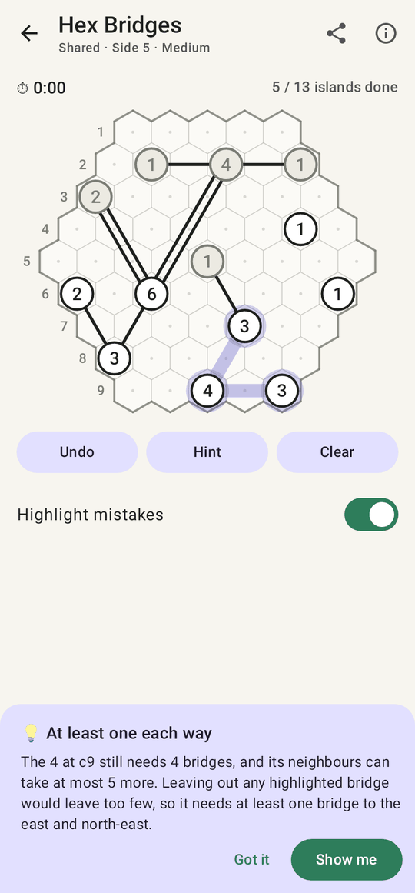
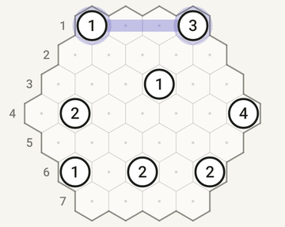
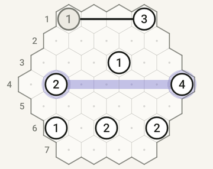
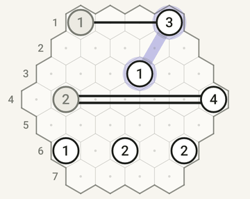
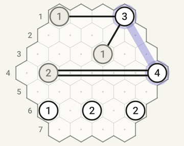
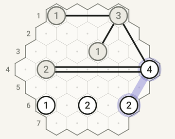
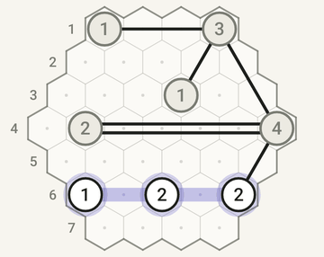
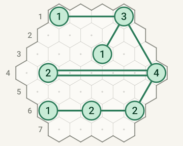

# Hex Bridges

*Bridge the islands in six directions*

## Rules

- Each circle is an island. Its number says how many bridges connect to it.

- Bridges run in straight lines along the rows of hexagons — across, or slanting either way — between two islands that see each other. At most two bridges join the same pair of islands.

- Bridges never cross each other or pass over an island: two bridges can't go through the same cell.

- When you're done, every island must be connected into one group.

Drag from an island toward a neighbouring island in any of the six directions to add a bridge; do it again for a double bridge, and once more to remove them. Tapping a bridge also cycles it.

Hints name an island by its place in its row and the row number (shown at the left of each row): c4 is the third cell from the left in row 4.

## Sizes and difficulty

Board sizes: Side 4, Side 5, Side 6, Side 7. Difficulty: Easy, Medium, Hard. The daily puzzle is small and easy early in the week and bigger and harder at the weekend.

## Learn to play

Tap 🎓 on the Hex Bridges menu for a short tutorial: these pages, then a guided puzzle where a coach shows every step.

**1. The goal.** Join the islands with bridges. Each island's number is how many bridges touch it. Bridges run straight along the rows of hexagons — across or slanting — at most two join a pair, they never cross, and in the end every island is linked into one group.

**2. Building bridges.** Drag from an island toward a neighbour in any of the six directions to build a bridge; again for a double, and once more to remove it. Rows are numbered on the left and cells lettered from the left of each row, so c2 is the third cell of row 2. An island whose neighbours can only just take its number needs bridges to all of them. The highlighted islands are the next step.

**3. Solved!.** Every island has its number of bridges, none cross, and all the islands are joined into one group. Your turn — the coach will show you one step at a time.

## Walkthrough

The tutorial puzzle, solved step by step the way the in-app coach explains it. Each picture shows the board before the step, with the part of the board the step is about highlighted.

| Board | Step |
|---|---|
|  | **1. Only one neighbour** The 1 at a1 still needs 1 bridge, and the only island it can reach is the 3 at d1, to the east. So the bridge must go there. |
|  | **2. Only one neighbour** The 2 at b4 still needs 2 bridges, and the only island it can reach is the 4 at g4, to the east. So both bridges must go there. |
|  | **3. Only one neighbour** The 1 at d3 still needs 1 bridge, and the only island it can still reach is the 3 at d1, to the north-east (its other neighbours are full or cut off by bridges). So the bridge must go there. |
|  | **4. Only one neighbour** The 3 at d1 still needs 1 bridge, and the only island it can still reach is the 4 at g4, to the south-east (its other neighbours are full or cut off by bridges). So the bridge must go there. |
|  | **5. Only one neighbour** The 4 at g4 still needs 1 bridge, and the only island it can still reach is the 2 at e6, to the south-west (its other neighbours are full or cut off by bridges). So the bridge must go there. |
|  | **6. Every bridge is needed** The 2 at c6 still needs 2 bridges. Between them, the islands it can still reach (east and west) can take at most 2 more (no more than two per pair, and no more than each neighbour still needs). That's exactly enough, so build every one of them. |
|  | **Solved!** Every rule is met. Now try a puzzle of your own. |

[← All puzzles](README.md) · [Using the app](../using-the-app.md)
