# Hex Islands

*Islands on a honeycomb of hexagons*

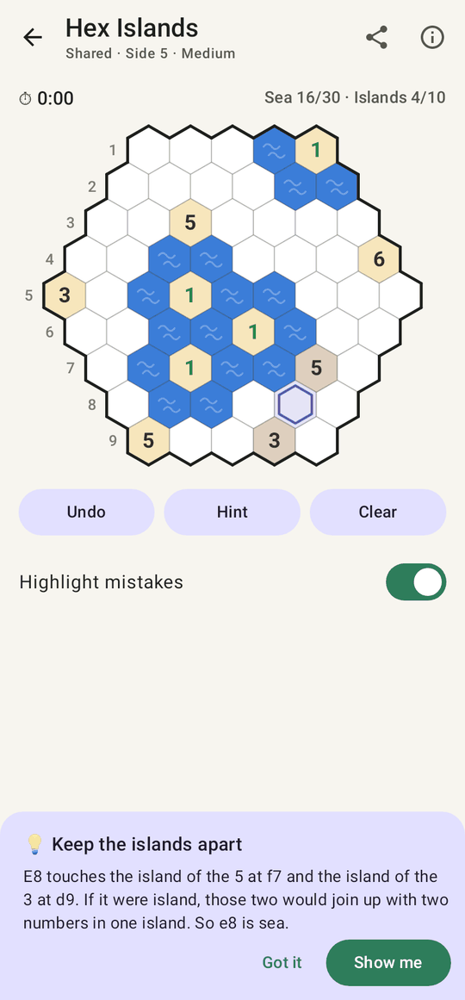

## Rules

- Shade cells to make the sea. The cells you leave unshaded form islands.

- Every island contains exactly one number, and that number is how many cells the island has.

- Islands never touch each other.

- All the sea is joined into one.

- Three sea cells never meet at a corner: of any three cells that all touch each other, at least one is island.

Tap a cell once to shade it as sea, again to mark it as island with a dot, and once more to clear it. Drag to paint several cells the same way.

Hints name a cell by its place in its row and the row number (shown at the left of each row): c4 is the third cell from the left in row 4.

## Sizes and difficulty

Board sizes: Side 4, Side 5, Side 6, Side 7. Difficulty: Easy, Medium, Hard. The daily puzzle is small and easy early in the week and bigger and harder at the weekend.

## Learn to play

Tap 🎓 on the Hex Islands menu for a short tutorial: these pages, then a guided puzzle where a coach shows every step.

**1. The goal.** Shade cells to make the sea. Every number sits on an island of exactly that many cells, with one number per island. Islands never touch, all the sea joins up, and three sea cells never meet at a corner.

**2. Shading the sea.** Tap a cell once to shade it as sea, twice to dot it as island, and again to clear it; drag to paint several. Rows are numbered on the left and cells lettered from the left of each row, so c2 is the third cell of row 2. A 1 is a whole island, so every cell around it is sea. The highlighted cells are the next step.

**3. Solved!.** Every island has its number of cells, the sea is all joined up and no three sea cells meet at a corner. Your turn — the coach will show you one step at a time.

## Walkthrough

The tutorial puzzle, solved step by step the way the in-app coach explains it. Each picture shows the board before the step, with the part of the board the step is about highlighted.

| Board | Step |
|---|---|
| 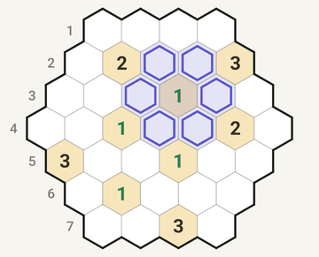 | **1. A 1 stands alone** A 1 is a whole island on its own, so every cell beside the 1 at d3 is sea: c2, d2, c3, e3 and 2 more. |
| 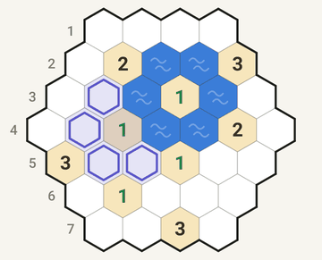 | **2. A 1 stands alone** A 1 is a whole island on its own, so every cell beside the 1 at c4 is sea: b3, b4, b5 and c5. |
| 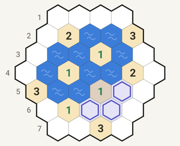 | **3. A 1 stands alone** A 1 is a whole island on its own, so every cell beside the 1 at d5 is sea: e5, c6 and d6. |
| 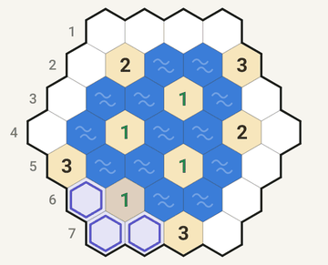 | **4. A 1 stands alone** A 1 is a whole island on its own, so every cell beside the 1 at b6 is sea: a6, a7 and b7. |
| 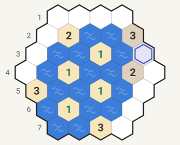 | **5. Keep the islands apart** F3 touches the island of the 3 at e2 and the island of the 2 at f4. If it were island, those two would join up with two numbers in one island. So f3 is sea. |
| 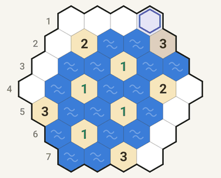 | **6. Only one way to grow** The 3 at e2 still needs 2 more cells, and d1 is the only cell it can grow into (the others are sea or would touch another island). So d1 is island. |
| 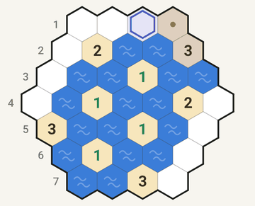 | **7. Only one way to grow** The 3 at e2 still needs 1 more cell, and c1 is the only cell it can grow into (the others are sea or would touch another island). So c1 is island. |
| 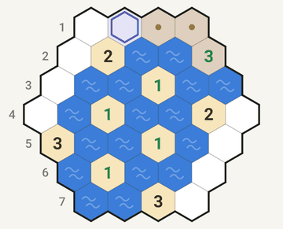 | **8. This island is finished** The island of the 3 at e2 already has all 3 of its cells. Nothing else may join it, so the cells around it are sea: b1. |
| 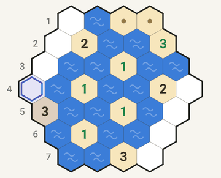 | **9. Only one way to grow** The 3 at a5 still needs 2 more cells, and a4 is the only cell it can grow into (the others are sea or would touch another island). So a4 is island. |
| 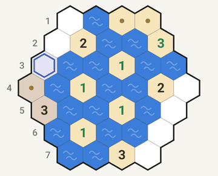 | **10. Only one way to grow** The 3 at a5 still needs 1 more cell, and a3 is the only cell it can grow into (the others are sea or would touch another island). So a3 is island. |
| 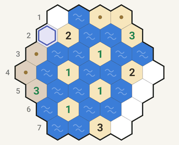 | **11. This island is finished** The island of the 3 at a5 already has all 3 of its cells. Nothing else may join it, so the cells around it are sea: a2. |
| 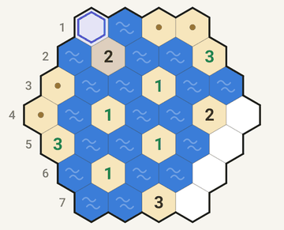 | **12. Only one way to grow** The 2 at b2 still needs 1 more cell, and a1 is the only cell it can grow into (the others are sea or would touch another island). So a1 is island. From here, the same techniques finish the puzzle. |
| 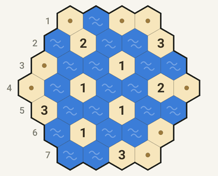 | **Solved!** Every rule is met. Now try a puzzle of your own. |

[← All puzzles](README.md) · [Using the app](../using-the-app.md)
