# Hex Link Up

*Join matching numbers across hexes*

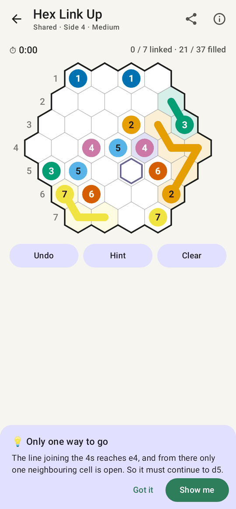

## Rules

- Join each pair of matching numbers with a single line.

- A line steps from a cell to any of its six neighbours. Lines never cross or branch, and never share a cell with another line (running side by side is fine).

- Together the lines must fill every cell of the board.

Drag from a number to draw its line, one neighbouring hex at a time. Drag back along a line to shorten it, or tap a number to clear its line. Drawing into another line cuts that line back.

Hints name a cell by its place in its row and the row number (shown at the left of each row): c4 is the third cell from the left in row 4.

## Sizes and difficulty

Board sizes: Side 3, Side 4, Side 5, Side 6. Difficulty: Easy, Medium, Hard. The daily puzzle is small and easy early in the week and bigger and harder at the weekend.

## Learn to play

Tap 🎓 on the Hex Link Up menu for a short tutorial: these pages, then a guided puzzle where a coach shows every step.

**1. The goal.** Join each pair of matching numbers with one line. A line steps from hex to neighbouring hex, in any of six directions. Lines never cross or share a cell, and together they must fill the whole board.

**2. Drawing lines.** Drag from a number to draw its line; drag back to shorten it, or tap the number to clear it. Rows are numbered on the left and cells lettered from the left of each row, so c2 is the third cell of row 2. Look for line ends with only one way to go, and cells that would be left with only one open side. The highlighted cells are the next step.

**3. Solved!.** Every pair is joined and every hex is filled. Your turn — the coach will show you one step at a time.

## Walkthrough

The tutorial puzzle, solved step by step the way the in-app coach explains it. Each picture shows the board before the step, with the part of the board the step is about highlighted.

| Board | Step |
|---|---|
| 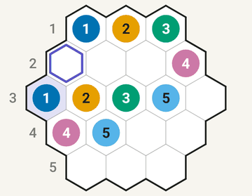 | **1. Only one way to go** The line joining the 1s reaches a3, and from there only one neighbouring cell is open. So it must continue to a2. |
| 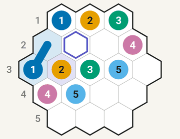 | **2. Only one way to go** The line joining the 2s reaches b3, and from there only one neighbouring cell is open. So it must continue to b2. |
| 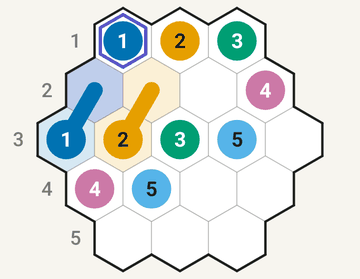 | **3. Only one way to go** The line joining the 1s reaches a2, and from there only one neighbouring cell is open. So it must join up with the other 1. |
| 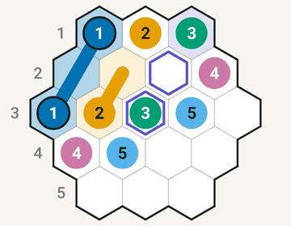 | **4. Only one way to go** The line joining the 3s reaches c1, and from there only one neighbouring cell is open. So it must continue to c2. After that the rest of the line is forced, all the way to the other 3. |
| 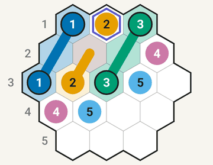 | **5. Only one way to go** The line joining the 2s reaches b2, and from there only one neighbouring cell is open. So it must join up with the other 2. |
| 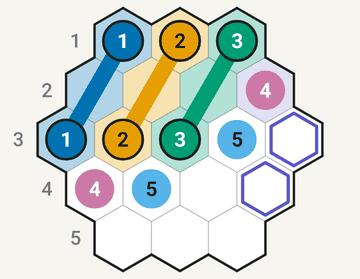 | **6. Only one way to go** The line joining the 4s reaches d2, and from there only one neighbouring cell is open. So it must continue to e3. From there, the next cell is forced too. |
| 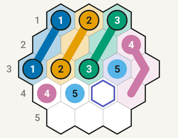 | **7. Only one way to go** The line joining the 5s reaches d3, and from there only one neighbouring cell is open. So it must continue to c4. |
| 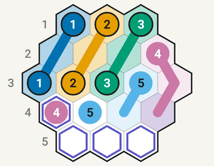 | **8. Only one way to go** The line joining the 4s reaches d4, and from there only one neighbouring cell is open. So it must continue to c5. After that the rest of the line is forced, all the way to the other 4. |
| 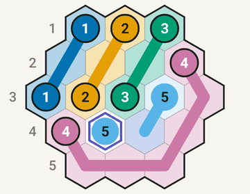 | **9. Only one way to go** The line joining the 5s reaches c4, and from there only one neighbouring cell is open. So it must join up with the other 5. |
| 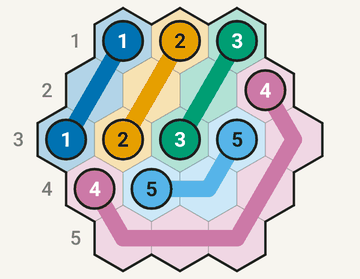 | **Solved!** Every rule is met. Now try a puzzle of your own. |

[← All puzzles](README.md) · [Using the app](../using-the-app.md)
