# Hex Minesweeper

*Find the mines on a honeycomb*

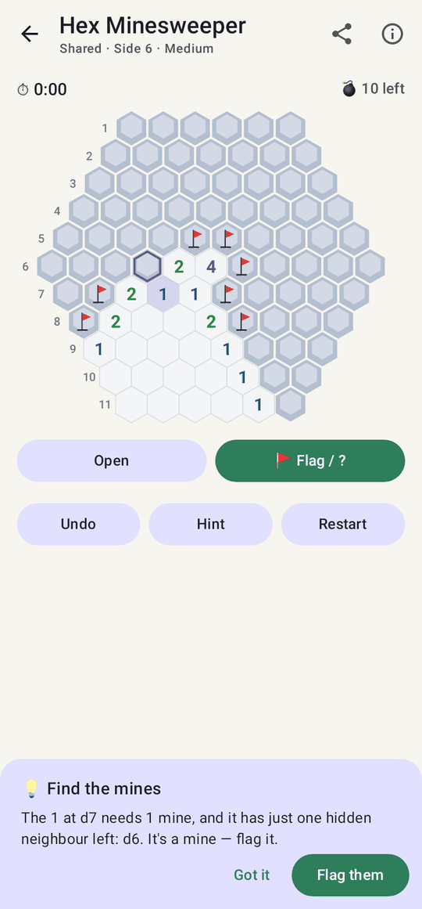

## Rules

- Some cells hide mines. Each number tells you how many mines touch that cell — a cell has up to six neighbours.

- Open every cell that isn't a mine to win. You start with a safe area already open, and every board can be solved by logic alone — no guessing.

The Flag tool is selected when you start: tap cells to cycle 🚩 flag → ? (just a note while you think — it doesn't count as a flag) → blank. Switch to Open to uncover cells; long-press flags in either mode. Tap an opened number whose mines are all flagged to open the rest of its neighbours.

Hints name a cell by its place in its row and the row number (shown at the left of each row): c4 is the third cell from the left in row 4. Big boards scroll: drag to move around and use − / + to zoom.

## Sizes and difficulty

Board sizes: Side 5, Side 6, Side 8, Side 10, Side 13. Difficulty: Easy, Medium, Hard. The daily puzzle is small and easy early in the week and bigger and harder at the weekend.

## Learn to play

Tap 🎓 on the Hex Minesweeper menu for a short tutorial: these pages, then a guided puzzle where a coach shows every step.

**1. The goal.** Open every cell that isn't a mine. Each number tells you how many mines touch that cell — on a honeycomb that's up to six neighbours. You start with a safe area already open, and you never need to guess.

**2. Finding mines.** The Flag tool is selected at first: tap to flag a mine (tap again for a ? note). Switch to Open to uncover cells. If a number has exactly as many hidden neighbours as mines, they're all mines; if its mines are all flagged, the rest are safe. Rows are numbered on the left, so c2 is the third cell of row 2.

**3. Cleared!.** Every safe cell is open. Now try it yourself — the coach will point out each safe move.

## Walkthrough

The tutorial puzzle, solved step by step the way the in-app coach explains it. Each picture shows the board before the step, with the part of the board the step is about highlighted.

| Board | Step |
|---|---|
| 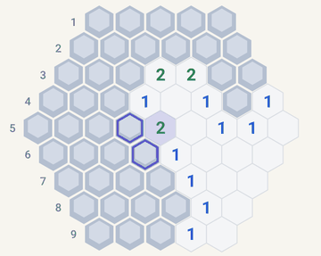 | **1. Find the mines** The 2 at e5 needs 2 mines, and it has exactly that many hidden neighbours left: d5 and d6. They're all mines — flag them. |
| 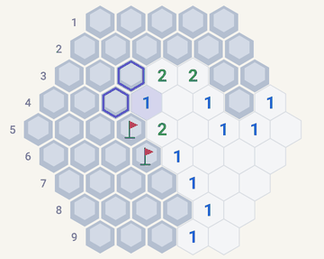 | **2. Safe cells** The 1 at d4 already touches 1 flagged mine — all it needs. So its other hidden neighbours (c3 and c4) are safe to open. |
| 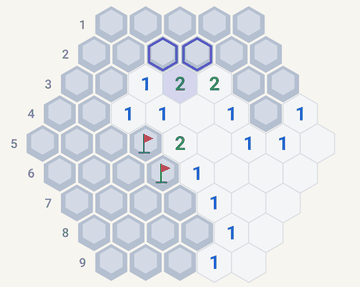 | **3. Find the mines** The 2 at d3 needs 2 mines, and it has exactly that many hidden neighbours left: c2 and d2. They're all mines — flag them. |
| 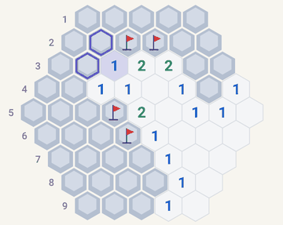 | **4. Safe cells** The 1 at c3 already touches 1 flagged mine — all it needs. So its other hidden neighbours (b2 and b3) are safe to open. |
| 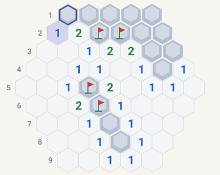 | **5. Find the mines** The 1 at a2 needs 1 mine, and it has just one hidden neighbour left: a1. It's a mine — flag it. |
| 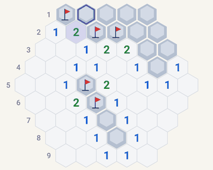 | **6. Safe cells** The 2 at b2 already touches 2 flagged mines — all it needs. So its other hidden neighbour (b1) is safe to open. |
| 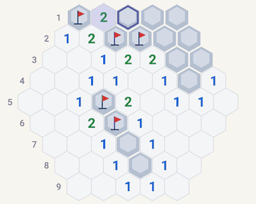 | **7. Safe cells** The 2 at b1 already touches 2 flagged mines — all it needs. So its other hidden neighbour (c1) is safe to open. |
| 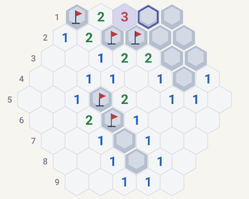 | **8. Find the mines** The 3 at c1 needs 1 more mine, and it has just one hidden neighbour left: d1. It's a mine — flag it. |
| 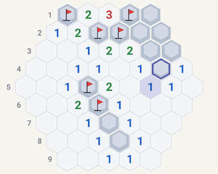 | **9. Find the mines** The 1 at g5 needs 1 mine, and it has just one hidden neighbour left: g4. It's a mine — flag it. |
| 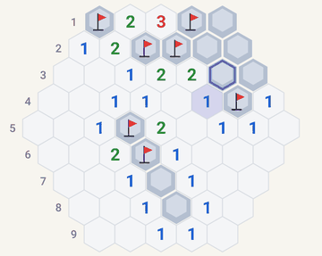 | **10. Safe cells** The 1 at f4 already touches 1 flagged mine — all it needs. So its other hidden neighbour (f3) is safe to open. |
| 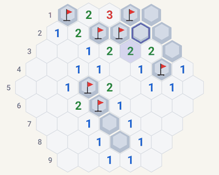 | **11. Find the mines** The 2 at e3 needs 1 more mine, and it has just one hidden neighbour left: e2. It's a mine — flag it. |
| 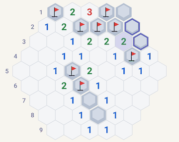 | **12. Safe cells** The 2 at f3 already touches 2 flagged mines — all it needs. So its other hidden neighbours (f2 and g3) are safe to open. From here, the same techniques finish the puzzle. |
| 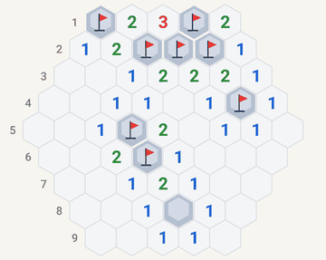 | **Solved!** Every rule is met. Now try a puzzle of your own. |

[← All puzzles](README.md) · [Using the app](../using-the-app.md)
