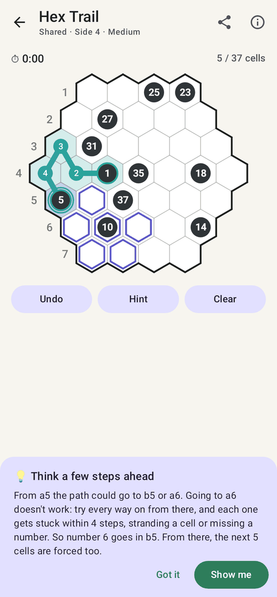
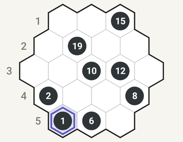
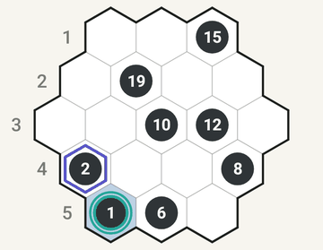
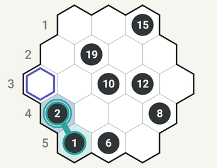
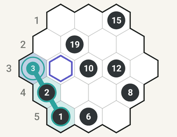
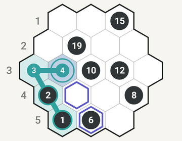
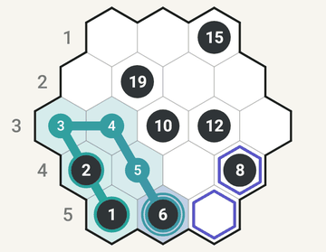
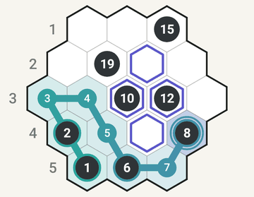
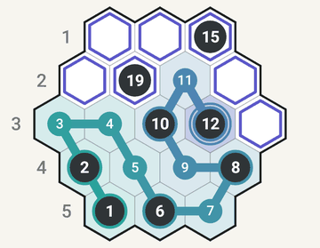
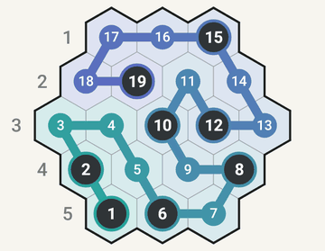

# Hex Trail

*Number every cell in one winding path*

## Rules

- Draw one path that starts at 1 and visits every cell exactly once, stepping between cells that share a side.

- Each cell's number is its place along the path: the first cell is 1, the next is 2, and so on up to the highest number, where the path ends.

- Some numbers are shown from the start. The path must reach each of them at exactly that step, so two numbers 3 apart are joined in exactly 3 steps.

Drag from 1 across neighbouring cells to draw the path; each cell's number appears as you go. Drag on from the path's end to carry on, or drag back along it to shorten it.

Hints name a cell by its place in its row and the row number (shown at the left of each row): c4 is the third cell from the left in row 4.

## Sizes and difficulty

Board sizes: Side 3, Side 4, Side 5. Difficulty: Easy, Medium, Hard. The daily puzzle is small and easy early in the week and bigger and harder at the weekend.

## Learn to play

Tap 🎓 on the Hex Trail menu for a short tutorial: these pages, then a guided puzzle where a coach shows every step.

**1. The goal.** Draw one path from 1 that visits every cell once, stepping between cells that share a side. A cell's number is its place along the path, so the numbers shown must line up: 5 is the fifth cell, and the path ends on the highest number.

**2. Drawing the path.** Drag from 1 across neighbouring cells; the numbers appear as you go, and dragging back shortens the path. Two numbers 3 apart must be joined in exactly 3 steps, and no cell may be left with only one way in. Rows are numbered on the left and cells lettered from the left of each row, so c2 is the third cell of row 2. The highlighted cells are the next step.

**3. Solved!.** Every cell has its number and the path is one unbroken line. Your turn — the coach will show you one step at a time.

## Walkthrough

The tutorial puzzle, solved step by step the way the in-app coach explains it. Each picture shows the board before the step, with the part of the board the step is about highlighted.

| Board | Step |
|---|---|
|  | **1. Start at 1** Every path starts on the cell marked 1, at a5. Drag from there across neighbouring cells to draw it. |
|  | **2. Follow the numbers** Number 2 is at a4, right next to a5, so the path steps straight there. |
|  | **3. Every cell needs a number** From a4 the path could go to b4 or b3 or a3. Going to b4 doesn't work: a3 couldn't get a number: it would be too far from the numbers still to come to fit between any two of them. Going to b3 doesn't work: a3 couldn't get a number: it would be too far from the numbers still to come to fit between any two of them. So number 3 goes in a3. |
|  | **4. Count the steps** From a3 the path could go to b3 or a2. Going to a2 doesn't work: a2 would be number 4, but number 6 at b5 is 3 steps away from it, and the path must get there in 2 steps. So number 4 goes in b3. |
|  | **5. Count the steps** From b3 the path could go to a2 or b4. Going to a2 doesn't work: a2 would be number 5, but number 6 at b5 is 3 steps away from it, and the path must get there in 1 step. So number 5 goes in b4. From there, the next cell is forced too. |
|  | **6. Every cell needs a number** From b5 the path could go to c5 or c4. Going to c4 doesn't work: c5 couldn't get a number: it would be too far from the numbers still to come to fit between any two of them. So number 7 goes in c5. From there, the next cell is forced too. |
|  | **7. Count the steps** From d4 the path could go to e3 or c4. Going to e3 doesn't work: e3 would be number 9, but number 10 at c3 is 2 steps away from it, and the path must get there in 1 step. So number 9 goes in c4. From there, the next 3 cells are forced too. |
|  | **8. Avoid dead ends** From d3 the path could go to e3 or d2. Going to d2 doesn't work: e3 would be left with only one way in, so the path would get stuck there. So number 13 goes in e3. From there, the next 6 cells are forced too. |
|  | **Solved!** Every rule is met. Now try a puzzle of your own. |

[← All puzzles](README.md) · [Using the app](../using-the-app.md)
