# Islands

*Shade the sea around numbered islands*

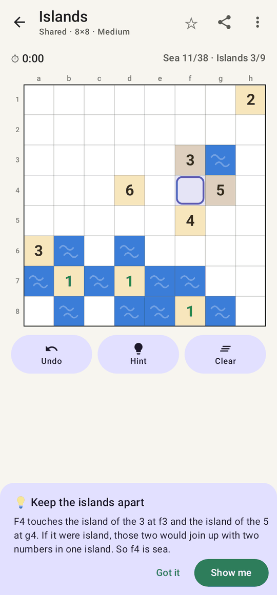

## Rules

- Shade squares to make the sea. The squares you leave unshaded form islands.

- Every island contains exactly one number, and that number is how many squares the island has.

- Islands never touch each other side by side (touching corners is fine).

- All the sea is joined into one, through squares that touch side by side.

- The sea never fills a 2×2 block.

Tap a square once to shade it as sea, again to mark it as island with a dot, and once more to clear it. Drag to paint several squares the same way.

## Sizes and difficulty

Board sizes: 6×6, 8×8, 10×10, 12×12, 6×9, 8×12. Difficulty: Easy, Medium, Hard. The daily puzzle is small and easy early in the week and bigger and harder at the weekend.

## Learn to play

Tap 🎓 on the Islands menu for a short tutorial: these pages, then a guided puzzle where a coach shows every step.

**1. The goal.** Shade squares to make the sea. Every number sits on an island of exactly that many squares, with one number per island. Islands never touch side by side, all the sea joins up, and the sea never fills a 2×2 block.

**2. Shading the sea.** Tap a square once to shade it as sea, twice to dot it as island, and again to clear it; drag to paint several. Start with the easy wins: a 1 is a whole island, so everything beside it is sea, and a square between two numbers is sea too. The highlighted squares are the next step.

**3. Solved!.** Every island has its number of squares, the sea is all joined up and there are no 2×2 pools. Your turn — the coach will show you one step at a time.

## Walkthrough

The tutorial puzzle, solved step by step the way the in-app coach explains it. Each picture shows the board before the step, with the part of the board the step is about highlighted.

| Board | Step |
|---|---|
| 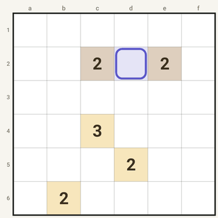 | **1. Keep the islands apart** D2 touches the island of the 2 at c2 and the island of the 2 at e2. If it were island, those two would join up with two numbers in one island. So d2 is sea. |
| 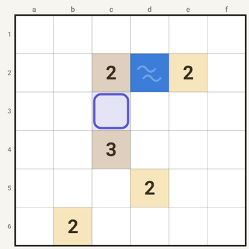 | **2. Keep the islands apart** C3 touches the island of the 2 at c2 and the island of the 3 at c4. If it were island, those two would join up with two numbers in one island. So c3 is sea. |
| 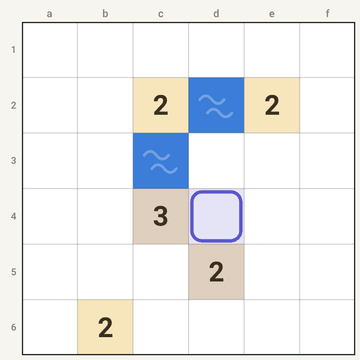 | **3. Keep the islands apart** D4 touches the island of the 3 at c4 and the island of the 2 at d5. If it were island, those two would join up with two numbers in one island. So d4 is sea. |
| 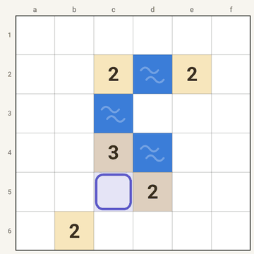 | **4. Keep the islands apart** C5 touches the island of the 3 at c4 and the island of the 2 at d5. If it were island, those two would join up with two numbers in one island. So c5 is sea. |
| 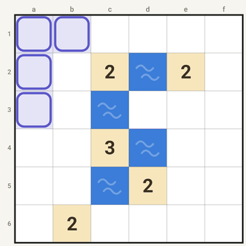 | **5. Too far from every number** No number can reach a1, b1, a2 and a3: every island is too small to stretch that far, or would have to touch another island on the way. Every island square belongs to a number, so they're all sea. |
| 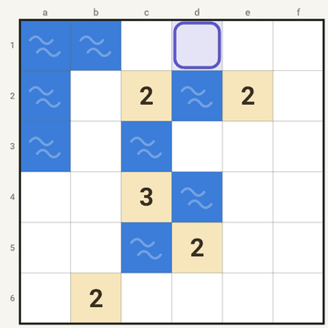 | **6. Too far from every number** No number can reach d1: every island is too small to stretch that far, or would have to touch another island on the way. Every island square belongs to a number, so it's sea. |
| 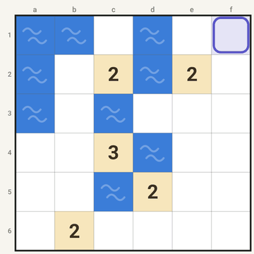 | **7. Too far from every number** No number can reach f1: every island is too small to stretch that far, or would have to touch another island on the way. Every island square belongs to a number, so it's sea. |
| 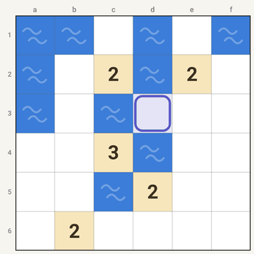 | **8. Too far from every number** No number can reach d3: every island is too small to stretch that far, or would have to touch another island on the way. Every island square belongs to a number, so it's sea. |
| 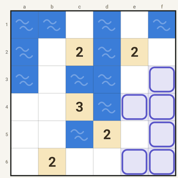 | **9. Too far from every number** No number can reach f3, e4, f4, f5 and 2 more: every island is too small to stretch that far, or would have to touch another island on the way. Every island square belongs to a number, so they're all sea. |
| 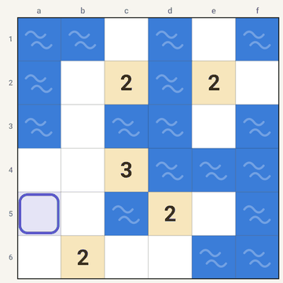 | **10. Too far from every number** No number can reach a5: every island is too small to stretch that far, or would have to touch another island on the way. Every island square belongs to a number, so it's sea. |
| 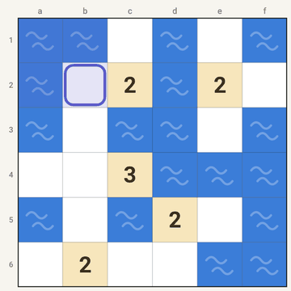 | **11. No 2×2 sea** A1, b1 and a2 are sea. If b2 were sea too, the sea would fill a 2×2 block, which isn't allowed. So b2 is island. |
| 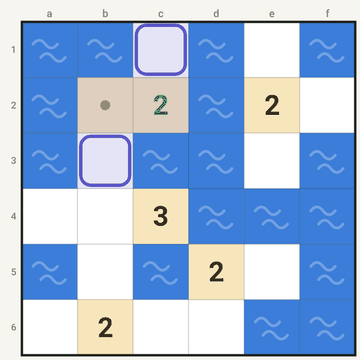 | **12. This island is finished** The island of the 2 at c2 already has all 2 of its squares. Nothing else may join it, so the squares around it are sea: c1 and b3. From here, the same techniques finish the puzzle. |
| 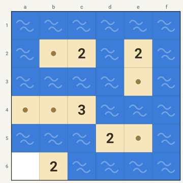 | **Solved!** Every rule is met. Now try a puzzle of your own. |

[← All puzzles](README.md) · [Using the app](../using-the-app.md)
