# Light Up

*Light every square without bulbs seeing each other*

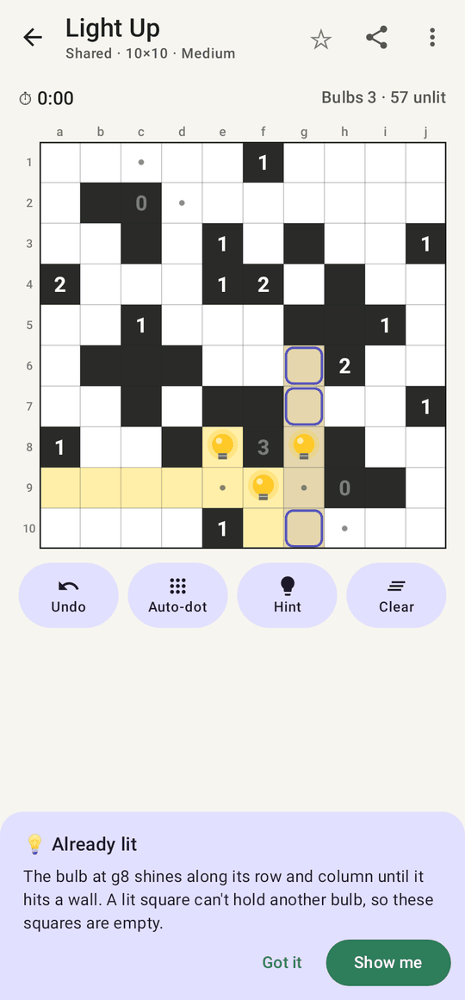

## Rules

- Place light bulbs in white squares so that every white square is lit.

- A bulb lights its own square and shines up, down, left and right until it hits a black wall or the edge.

- Two bulbs may never shine on each other.

- A number on a black wall says exactly how many bulbs sit directly above, below, left and right of it.

Tap a square once to mark it as empty (a dot), again for a bulb, and once more to clear it.

## Sizes and difficulty

Board sizes: 7×7, 10×10, 12×12, 7×10, 10×14. Difficulty: Easy, Medium, Hard. The daily puzzle is small and easy early in the week and bigger and harder at the weekend.

## Learn to play

Tap 🎓 on the Light Up menu for a short tutorial: these pages, then a guided puzzle where a coach shows every step.

**1. The goal.** Place bulbs so every white square is lit. Bulbs shine along their row and column until a black wall, and two bulbs may never shine on each other. A numbered wall has exactly that many bulbs next to it.

**2. Placing bulbs.** Tap a square once to mark it empty (a dot), twice for a bulb. A 0 wall means no bulbs beside it; a number with exactly enough open neighbours gets bulbs in all of them. The highlighted square is the next step.

**3. Solved!.** Everything is lit and no bulbs see each other. Your turn!

## Walkthrough

The tutorial puzzle, solved step by step the way the in-app coach explains it. Each picture shows the board before the step, with the part of the board the step is about highlighted.

| Board | Step |
|---|---|
| 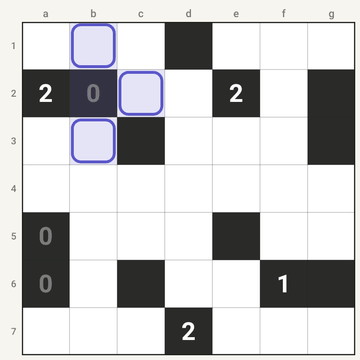 | **1. Nothing next to a 0** A 0 means no bulb touches it, so the squares above, below, left and right of the 0 at b2 are all empty. |
| 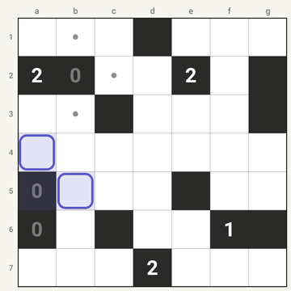 | **2. Nothing next to a 0** A 0 means no bulb touches it, so the squares above, below, left and right of the 0 at a5 are all empty. |
| 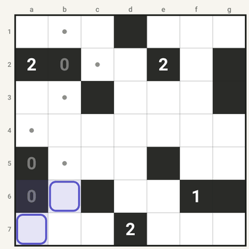 | **3. Nothing next to a 0** A 0 means no bulb touches it, so the squares above, below, left and right of the 0 at a6 are all empty. |
| 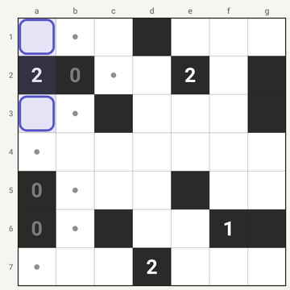 | **4. Every spot is needed** The 2 at a2 needs 2 bulbs, and it has exactly 2 open squares beside it. So they all hold bulbs. |
| 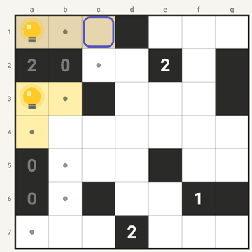 | **5. Already lit** The bulb at a1 shines along its row and column until it hits a wall. A lit square can't hold another bulb, so these squares are empty. |
| 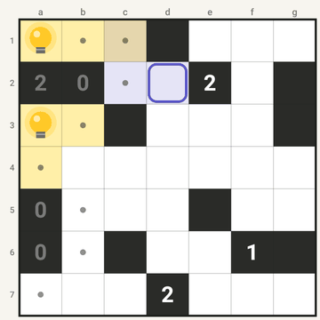 | **6. Only one way to light it** C2 isn't lit yet, and the only square left that could light it is d2. So the bulb goes there. |
| 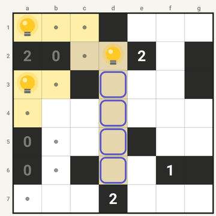 | **7. Already lit** The bulb at d2 shines along its row and column until it hits a wall. A lit square can't hold another bulb, so these squares are empty. |
| 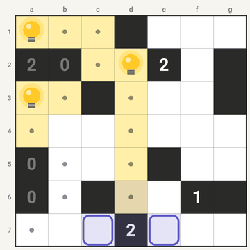 | **8. Every spot is needed** The 2 at d7 needs 2 bulbs, and it has exactly 2 open squares beside it. So they all hold bulbs. |
| 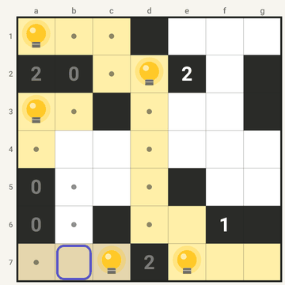 | **9. Already lit** The bulb at c7 shines along its row and column until it hits a wall. A lit square can't hold another bulb, so these squares are empty. |
| 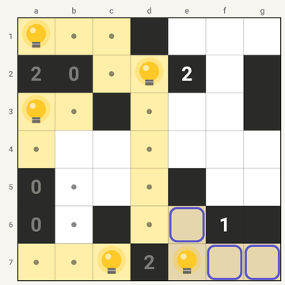 | **10. Already lit** The bulb at e7 shines along its row and column until it hits a wall. A lit square can't hold another bulb, so these squares are empty. |
| 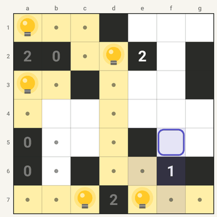 | **11. Every spot is needed** The 1 at f6 needs 1 bulb, and it has exactly 1 open square beside it. So they all hold bulbs. |
| 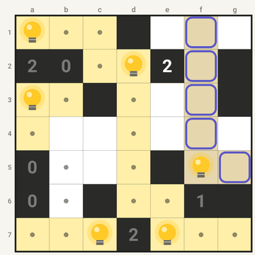 | **12. Already lit** The bulb at f5 shines along its row and column until it hits a wall. A lit square can't hold another bulb, so these squares are empty. From here, the same techniques finish the puzzle. |
| 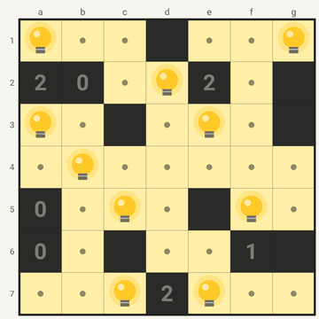 | **Solved!** Every rule is met. Now try a puzzle of your own. |

[← All puzzles](README.md) · [Using the app](../using-the-app.md)
