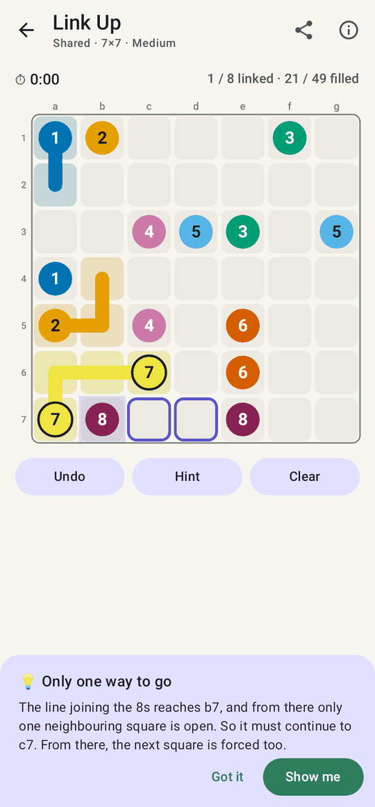

# Link Up

*Join matching numbers and fill every square*

## Rules

- Join each pair of matching numbers with a single line.

- Lines run up, down, left and right, never cross or branch, and never share a square with another line (running side by side is fine).

- Together the lines must fill every square of the grid.

- On Expert, thick bars between squares are barriers: a line can't cross them.

Drag from a number to draw its line. Drag back along a line to shorten it, or tap a number to clear its line. Drawing into another line cuts that line back.

## Sizes and difficulty

Board sizes: 5×5, 7×7, 9×9. Difficulty: Easy, Medium, Hard, Expert. The daily puzzle is small and easy early in the week and bigger and harder at the weekend.

## Learn to play

Tap 🎓 on the Link Up menu for a short tutorial: these pages, then a guided puzzle where a coach shows every step.

**1. The goal.** Join each pair of matching numbers with a line. Lines go up, down, left and right, never cross or share a square, and together they fill the whole grid.

**2. Drawing lines.** Drag from a number to draw its line; drag back to shorten it, or tap a number to clear it. Squares in corners and dead ends often have only one way to be filled. The highlighted squares are the next step.

**3. Solved!.** Every pair is joined and every square is filled. Now link them yourself.

[← All puzzles](README.md) · [Using the app](../using-the-app.md)
