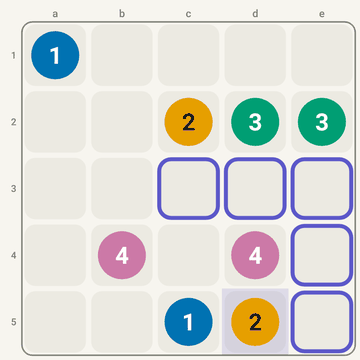
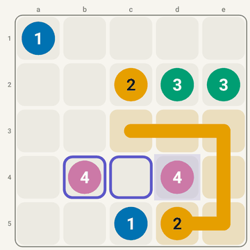
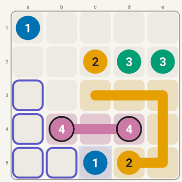
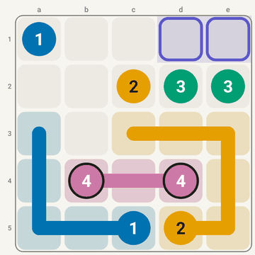
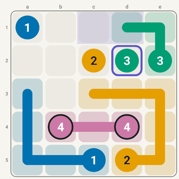
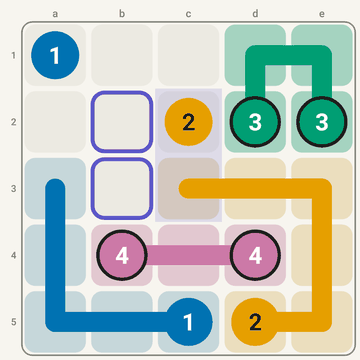
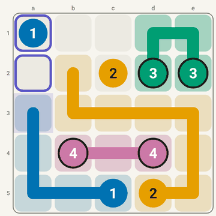
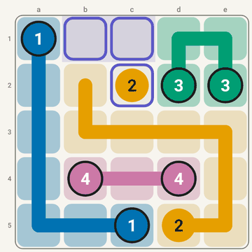
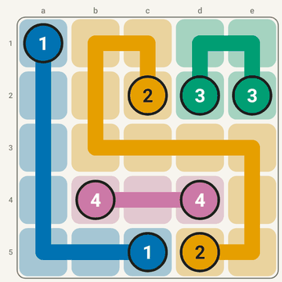

# Link Up

*Join matching numbers and fill every square*

## Rules

- Join each pair of matching numbers with a single line.

- Lines run up, down, left and right, never cross or branch, and never share a square with another line (running side by side is fine).

- Together the lines must fill every square of the grid.

- On Expert, thick bars between squares are barriers: a line can't cross them.

Drag from a number to draw its line. Drag back along a line to shorten it, or tap a number to clear its line. Drawing into another line cuts that line back.

## Sizes and difficulty

Board sizes: 5×5, 7×7, 9×9. Difficulty: Easy, Medium, Hard, Expert. The daily puzzle is small and easy early in the week and bigger and harder at the weekend.

## Learn to play

Tap 🎓 on the Link Up menu for a short tutorial: these pages, then a guided puzzle where a coach shows every step.

**1. The goal.** Join each pair of matching numbers with a line. Lines go up, down, left and right, never cross or share a square, and together they fill the whole grid.

**2. Drawing lines.** Drag from a number to draw its line; drag back to shorten it, or tap a number to clear it. Squares in corners and dead ends often have only one way to be filled. The highlighted squares are the next step.

**3. Solved!.** Every pair is joined and every square is filled. Now link them yourself.

## Walkthrough

The tutorial puzzle, solved step by step the way the in-app coach explains it. Each picture shows the board before the step, with the part of the board the step is about highlighted.

| Board | Step |
|---|---|
|  | **1. Only one way to go** The line joining the 2s reaches d5, and from there only one neighbouring square is open. So it must continue to e5. From there, the next 4 squares are forced too. |
|  | **2. Only one way to go** The line joining the 4s reaches d4, and from there only one neighbouring square is open. So it must continue to c4. After that the rest of the line is forced, all the way to the other 4. |
|  | **3. Only one way to go** The line joining the 1s reaches c5, and from there only one neighbouring square is open. So it must continue to b5. From there, the next 3 squares are forced too. |
|  | **4. Fill the corner** E1 is a corner, so it touches only two squares: e2 and d1. Every square must be filled, so a line has to come in one side and leave by the other. The line joining the 3s at e2 is the one that must pass through it. From there, the next square is forced too. |
|  | **5. Rule out the other ways** From d1 the line joining the 3s could go to c1 or the other 3. Going to c1 fails: the 3s would be cut off from each other. So it must join up with the other 3. |
|  | **6. Rule out the other ways** From c3 the line joining the 2s could go to the other 2 or b3. Going to the other 2 fails: c1 would be boxed in with only one open side, so no line could pass through it. So it must continue to b3. From there, the next square is forced too. |
|  | **7. Only one way to go** The line joining the 1s reaches a3, and from there only one neighbouring square is open. So it must continue to a2. After that the rest of the line is forced, all the way to the other 1. |
|  | **8. Don't strand a square** B1 has only two open sides: b2 and c1. Every square must be filled, so a line has to come in one side and leave by the other. The line joining the 2s at b2 is the one that must pass through it. After that the rest of the line is forced, all the way to the other 2. |
|  | **Solved!** Every rule is met. Now try a puzzle of your own. |

[← All puzzles](README.md) · [Using the app](../using-the-app.md)
