# Minesweeper

*Find the mines — no guessing needed*

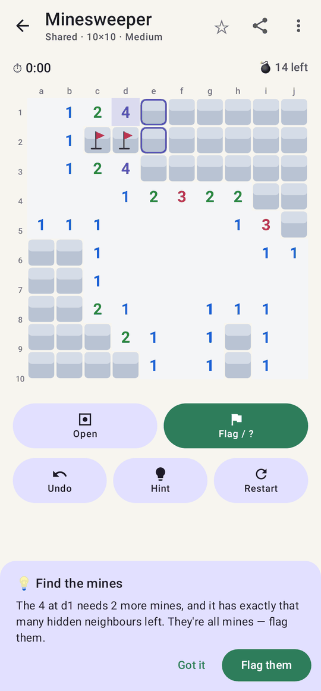

## Rules

- Each number tells you how many mines touch that square, including diagonally.

- Open every square that isn't a mine to win. You start with a safe area already open, and every board can be solved by logic alone — no guessing.

The Flag tool is selected when you start: tap squares to cycle 🚩 flag → ? (just a note while you think — it doesn't count as a flag) → blank. Switch to Open to uncover squares; long-press flags in either mode. Tap an opened number whose mines are all flagged to open the rest of its neighbours.

Big boards scroll: drag to move around, and pinch or use − / + to zoom. On the largest boards a few extra safe areas may start open so no guessing is ever needed.

## Sizes and difficulty

Board sizes: 8×8, 10×10, 12×12, 16×16, 16×30, 30×30, 50×50, 9×14, 12×20. Difficulty: Easy, Medium, Hard. The daily puzzle is small and easy early in the week and bigger and harder at the weekend.

## Learn to play

Tap 🎓 on the Minesweeper menu for a short tutorial: these pages, then a guided puzzle where a coach shows every step.

**1. The goal.** Open every square that isn't a mine. Each number tells you how many mines touch that square, including diagonally. You start with a safe area already open, and you never need to guess.

**2. Finding mines.** The Flag tool is selected at first: tap to flag a mine (tap again for a ? note). Switch to Open to uncover squares. If a number has exactly as many hidden neighbours as mines, they're all mines; if its mines are all flagged, the rest are safe.

**3. Cleared!.** Every safe square is open. Now try it — the coach will point out each safe move.

## Walkthrough

The tutorial puzzle, solved step by step the way the in-app coach explains it. Each picture shows the board before the step, with the part of the board the step is about highlighted.

| Board | Step |
|---|---|
| 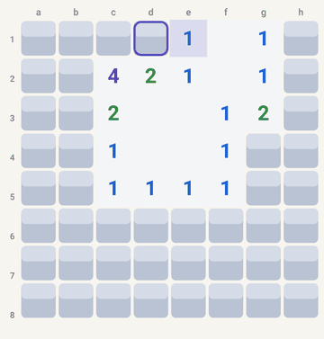 | **1. Find the mines** The 1 at e1 needs 1 more mine, and it has exactly that many hidden neighbours left. They're all mines — flag them. |
| 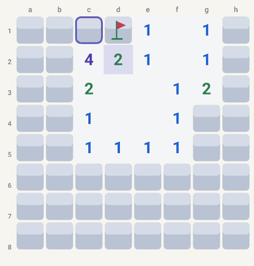 | **2. Find the mines** The 2 at d2 needs 1 more mine, and it has exactly that many hidden neighbours left. They're all mines — flag them. |
| 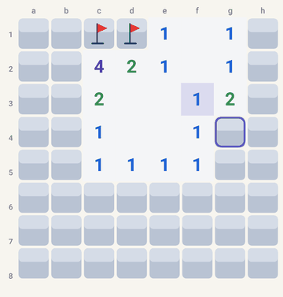 | **3. Find the mines** The 1 at f3 needs 1 more mine, and it has exactly that many hidden neighbours left. They're all mines — flag them. |
| 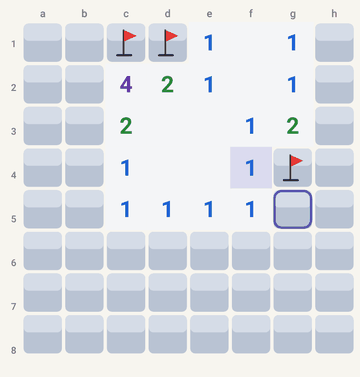 | **4. Safe squares** The 1 at f4 already touches 1 flagged mine — all it needs. So its other hidden neighbours are safe to open. |
| 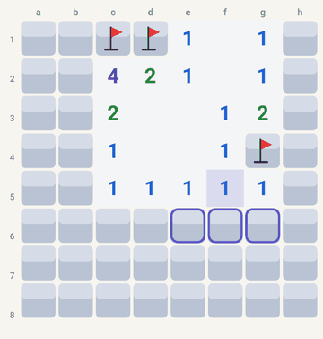 | **5. Safe squares** The 1 at f5 already touches 1 flagged mine — all it needs. So its other hidden neighbours are safe to open. |
| 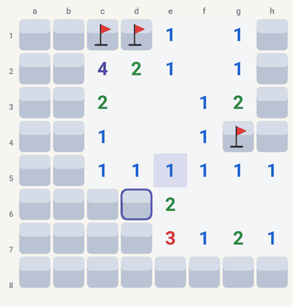 | **6. Find the mines** The 1 at e5 needs 1 more mine, and it has exactly that many hidden neighbours left. They're all mines — flag them. |
| 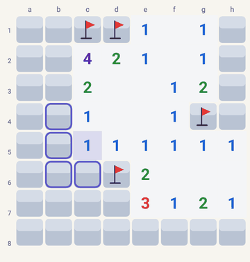 | **7. Safe squares** The 1 at c5 already touches 1 flagged mine — all it needs. So its other hidden neighbours are safe to open. |
| 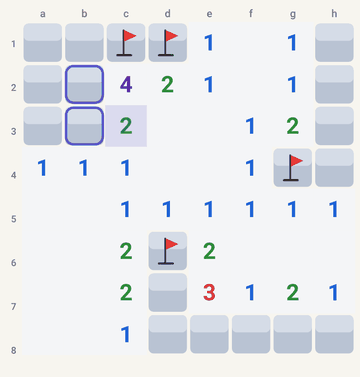 | **8. Find the mines** The 2 at c3 needs 2 more mines, and it has exactly that many hidden neighbours left. They're all mines — flag them. |
| 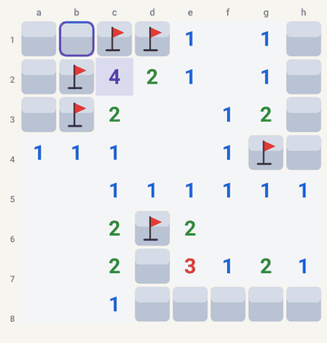 | **9. Safe squares** The 4 at c2 already touches 4 flagged mines — all it needs. So its other hidden neighbours are safe to open. |
| 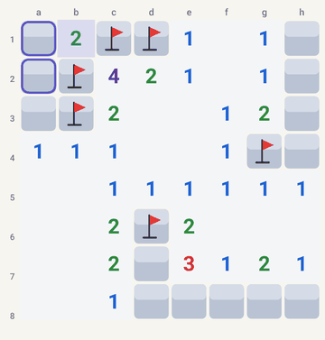 | **10. Safe squares** The 2 at b1 already touches 2 flagged mines — all it needs. So its other hidden neighbours are safe to open. |
| 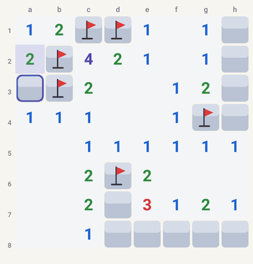 | **11. Safe squares** The 2 at a2 already touches 2 flagged mines — all it needs. So its other hidden neighbours are safe to open. |
| 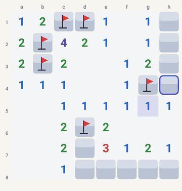 | **12. Safe squares** The 1 at g5 already touches 1 flagged mine — all it needs. So its other hidden neighbours are safe to open. From here, the same techniques finish the puzzle. |
| 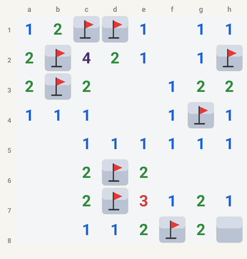 | **Solved!** Every rule is met. Now try a puzzle of your own. |

[← All puzzles](README.md) · [Using the app](../using-the-app.md)
