# Panda Pairs

*Pair every bamboo with a hungry panda*

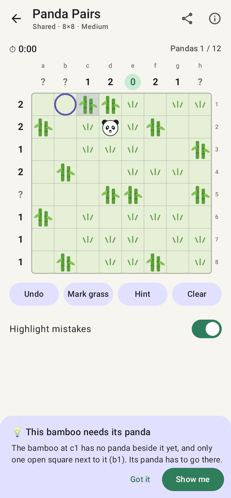

## Rules

- Row and column clues: the numbers along the top and left edges show how many pandas belong in that row or column (0 means none). On harder levels some clues are hidden as "?" — there's one panda per bamboo, so a single missing clue can be worked out from the others.

- Bamboo pairing: every bamboo pairs with exactly one panda placed directly above, below, left or right of it. There are as many pandas as bamboo.

- No touching: pandas can't be next to each other — not even diagonally.

Tap a square once to mark it as grass (definitely empty), tap again for a panda, and once more to clear it. Tap a clue number to fill the rest of its line with grass once it's satisfied. Clues turn green when satisfied and red when exceeded.

## Sizes and difficulty

Board sizes: 6×6, 8×8, 10×10, 12×12. Difficulty: Easy, Medium, Hard. The daily puzzle is small and easy early in the week and bigger and harder at the weekend.

## Learn to play

Tap 🎓 on the Panda Pairs menu for a short tutorial: these pages, then a guided puzzle where a coach shows every step.

**1. The goal.** Every bamboo needs its own panda, right next to it — above, below, left or right. The numbers around the edge say how many pandas go in each row and column.

**2. Placing pandas.** Tap a square once to mark it as grass (no panda), twice for a panda. Pandas can't touch each other, not even diagonally. Start with the easy wins: rows with a 0 are all grass, and a bamboo with only one free square beside it gets its panda there. The highlighted squares are the next step.

**3. Solved!.** Every bamboo has a panda, every clue is met, and no two pandas touch. Now try it yourself — the coach will guide you one step at a time.

## Walkthrough

The tutorial puzzle, solved step by step the way the in-app coach explains it. Each picture shows the board before the step, with the part of the board the step is about highlighted.

| Board | Step |
|---|---|
| 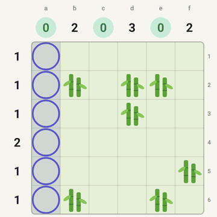 | **1. Line is complete** The clue for column a is 0, so no panda can go anywhere in it. Mark its squares as grass. |
| 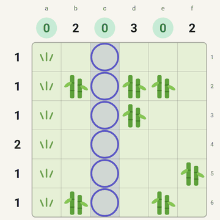 | **2. Line is complete** The clue for column c is 0, so no panda can go anywhere in it. Mark its squares as grass. |
| 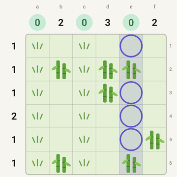 | **3. Line is complete** The clue for column e is 0, so no panda can go anywhere in it. Mark its squares as grass. |
| 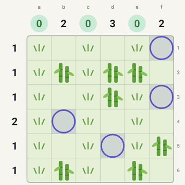 | **4. No bamboo nearby** A panda must sit directly above, below, left or right of a bamboo. The highlighted squares have no bamboo touching their sides, so they can only be grass. |
| 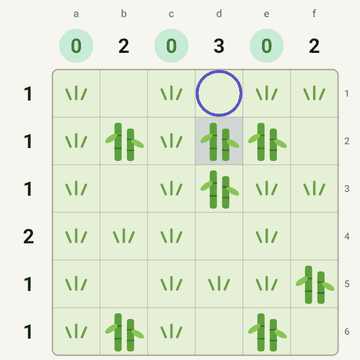 | **5. This bamboo needs its panda** The bamboo at d2 has no panda beside it yet, and only one open square next to it (d1). Its panda has to go there. |
| 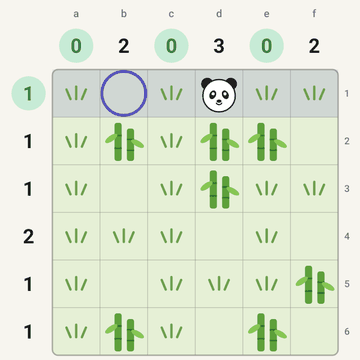 | **6. Line is complete** Row 1 already has all 1 panda its clue asks for, so every other square in it is grass. |
| 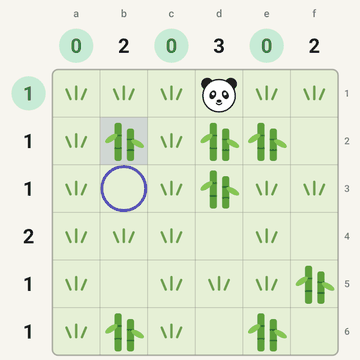 | **7. This bamboo needs its panda** The bamboo at b2 has no panda beside it yet, and only one open square next to it (b3). Its panda has to go there. |
| 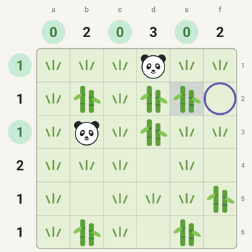 | **8. This bamboo needs its panda** The bamboo at e2 has no panda beside it yet, and only one open square next to it (f2). Its panda has to go there. |
| 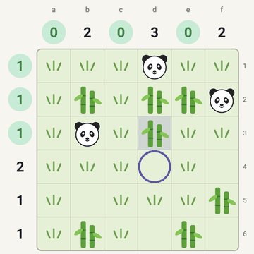 | **9. This bamboo needs its panda** The bamboo at d3 has no panda beside it yet, and only one open square next to it (d4). Its panda has to go there. |
| 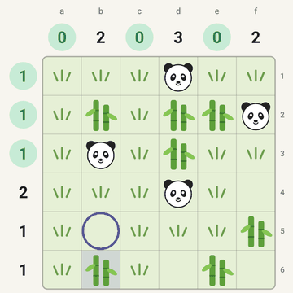 | **10. This bamboo needs its panda** The bamboo at b6 has no panda beside it yet, and only one open square next to it (b5). Its panda has to go there. |
| 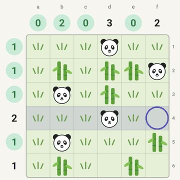 | **11. Every open square is needed** Row 4 still needs 1 panda and has exactly 1 open square left, so it is a panda. |
| 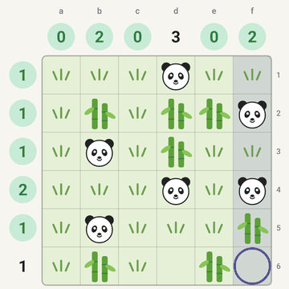 | **12. Line is complete** Column f already has all 2 pandas its clue asks for, so every other square in it is grass. From here, the same techniques finish the puzzle. |
| 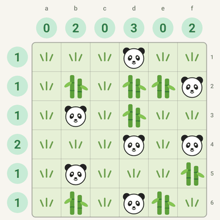 | **Solved!** Every rule is met. Now try a puzzle of your own. |

[← All puzzles](README.md) · [Using the app](../using-the-app.md)
