# Pearls

*Draw one loop through every pearl*

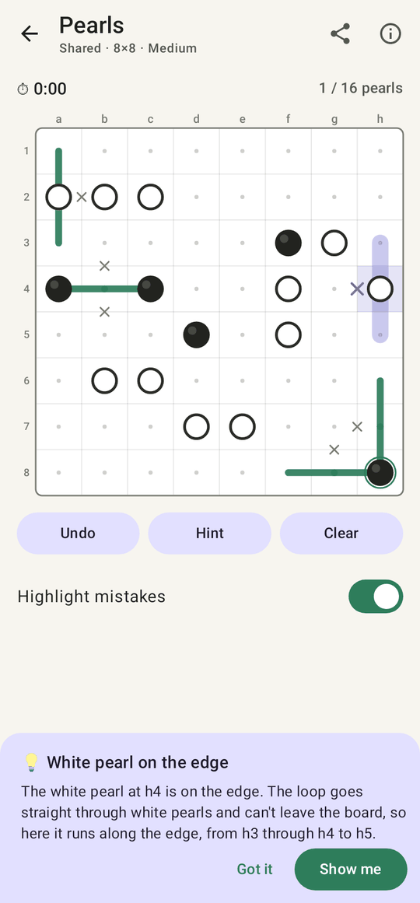

## Rules

- Draw a single closed loop through the centres of the squares. It runs up, down, left and right, never crosses or branches, and doesn't have to visit every square.

- The loop passes through every pearl.

- White pearl: the loop goes straight through it, and turns in at least one of the squares just before or just after it.

- Black pearl: the loop turns at it, and goes straight through the next square on both sides.

Drag across the squares to draw the loop; drag back to take back the last step, or start a drag on a line to rub lines out. Tap between two squares to cycle line → cross (definitely no line) → empty. Pearls whose rule is broken turn red.

## Sizes and difficulty

Board sizes: 6×6, 8×8, 10×10, 12×12. Difficulty: Easy, Medium, Hard. The daily puzzle is small and easy early in the week and bigger and harder at the weekend.

## Learn to play

Tap 🎓 on the Pearls menu for a short tutorial: these pages, then a guided puzzle where a coach shows every step.

**1. The goal.** Draw one closed loop through the centres of the squares that passes through every pearl. At a white pearl the loop goes straight, and turns just before or after it. At a black pearl it turns, then runs straight through the next square on both sides.

**2. Drawing the loop.** Drag across the squares to draw lines; tap between two squares to cross a link out. A black pearl beside the edge must head away from it, and a white pearl on the edge runs along it. The highlighted links are the next step.

**3. Solved!.** One loop, and every pearl is happy. Now try it yourself — the coach will guide you one step at a time.

## Walkthrough

The tutorial puzzle, solved step by step the way the in-app coach explains it. Each picture shows the board before the step, with the part of the board the step is about highlighted.

| Board | Step |
|---|---|
| 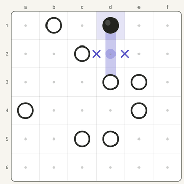 | **1. Black pearl near the edge** The loop turns at the black pearl at d1 and then has to run straight through the next square. It can't go up: it sits right on the edge. So it goes down, straight through d2 and on to d3. |
| 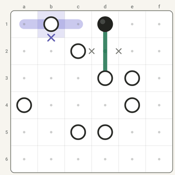 | **2. White pearl on the edge** The white pearl at b1 is on the edge. The loop goes straight through white pearls and can't leave the board, so here it runs along the edge, from c1 through b1 to a1. |
| 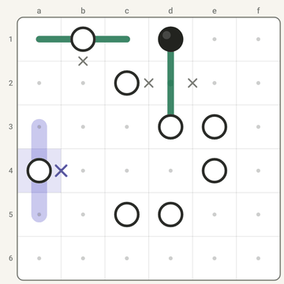 | **3. White pearl on the edge** The white pearl at a4 is on the edge. The loop goes straight through white pearls and can't leave the board, so here it runs along the edge, from a3 through a4 to a5. |
| 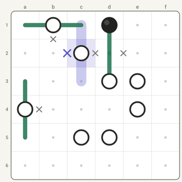 | **4. A white pearl goes straight** The loop goes straight through a white pearl. At c2 it can't go right, so it runs up and down, from c1 through c2 to c3. |
| 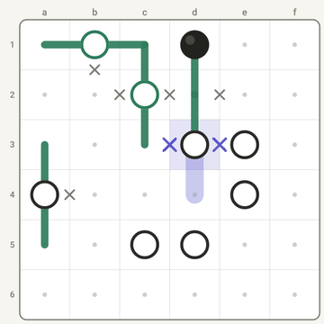 | **5. A white pearl goes straight** The loop goes straight through a white pearl. At d3 the loop already goes up from it, so it runs up and down, from d2 through d3 to d4. |
| 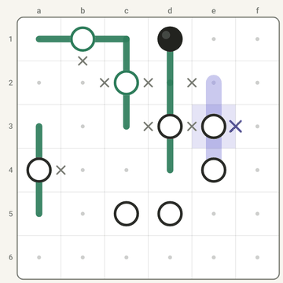 | **6. A white pearl goes straight** The loop goes straight through a white pearl. At e3 it can't go left, so it runs up and down, from e2 through e3 to e4. |
| 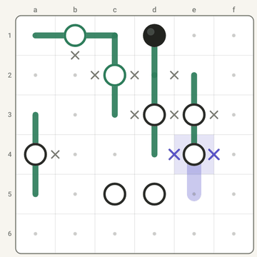 | **7. A white pearl goes straight** The loop goes straight through a white pearl. At e4 the loop already goes up from it, so it runs up and down, from e3 through e4 to e5. |
| 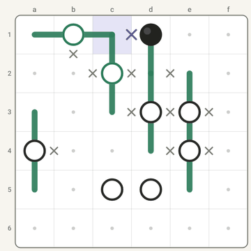 | **8. Two lines already** The loop already goes in and out of c1. It never branches, so the other links around c1 are empty. |
| 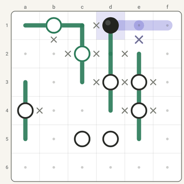 | **9. A black pearl turns** The loop turns at the black pearl at d1, so it uses one of up and down and one of left and right. It can't go left, so it goes right, straight through e1 and on to f1. |
| 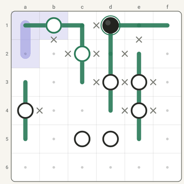 | **10. Keep the line going** A line reaches a1 and has only one way to go on. The loop never stops, so it must continue to a2. |
| 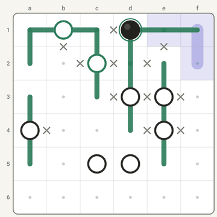 | **11. Keep the line going** A line reaches f1 and has only one way to go on. The loop never stops, so it must continue to f2. |
| 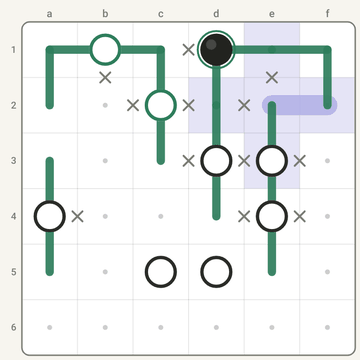 | **12. Keep the line going** A line reaches e2 and has only one way to go on. The loop never stops, so it must continue to f2. From here, the same techniques finish the puzzle. |
| 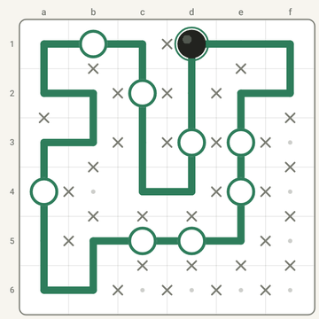 | **Solved!** Every rule is met. Now try a puzzle of your own. |

[← All puzzles](README.md) · [Using the app](../using-the-app.md)
