# Pipes

*Turn the tiles to join every pipe*

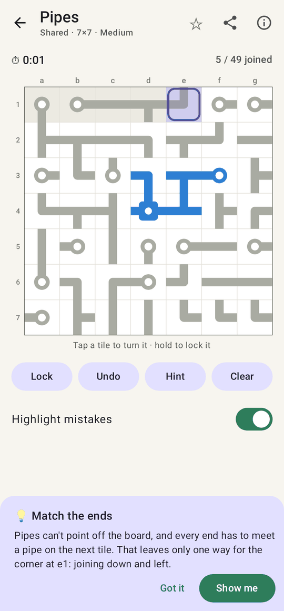

## Rules

- Every tile holds a piece of pipe. Turn the tiles so that all the pipes join up into one network.

- Every pipe end must meet a pipe end on the next tile: nothing may point at the edge of the board or at a tile without a pipe there.

- The network has no closed loops: there's exactly one way through the pipes between any two tiles.

Tap a tile to turn it a quarter turn clockwise. Press and hold a tile to lock it once you're sure (locked tiles don't turn); hold again to unlock. Water flows from the tap in the middle, so the tiles joined to it fill up as you go.

## Sizes and difficulty

Board sizes: 5×5, 7×7, 9×9, 11×11. Difficulty: Easy, Medium, Hard. The daily puzzle is small and easy early in the week and bigger and harder at the weekend.

## Learn to play

Tap 🎓 on the Pipes menu for a short tutorial: these pages, then a guided puzzle where a coach shows every step.

**1. The goal.** Turn the tiles so every pipe joins up into one network, with no loops. Every pipe end has to meet another pipe end; nothing can point at the edge of the board.

**2. Turning tiles.** Tap a tile to turn it clockwise, and press and hold to lock it when you're sure. Start at the edges: a straight pipe on the edge has to run along it, and a corner in a corner of the board can only face inwards. The highlighted tile is the next step.

**3. Solved!.** Every pipe is joined, water reaches every tile and there are no loops. Now try it yourself — the coach will guide you one step at a time.

## Walkthrough

The tutorial puzzle, solved step by step the way the in-app coach explains it. Each picture shows the board before the step, with the part of the board the step is about highlighted.

| Board | Step |
|---|---|
| 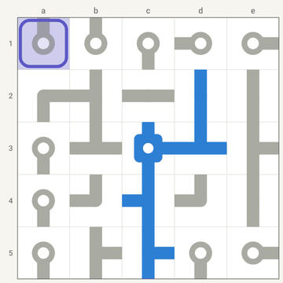 | **1. Match the ends** Pipes can't point off the board, and every end has to meet a pipe on the next tile. That leaves only one way for the dead end at a1: pointing down. |
| 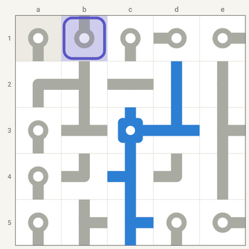 | **2. Match the ends** Pipes can't point off the board, and every end has to meet a pipe on the next tile. That leaves only one way for the dead end at b1: pointing down. |
| 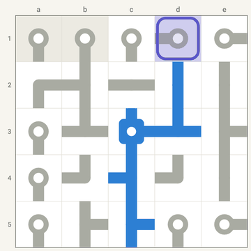 | **3. Match the ends** Pipes can't point off the board, and every end has to meet a pipe on the next tile. That leaves only one way for the dead end at d1: pointing down. |
| 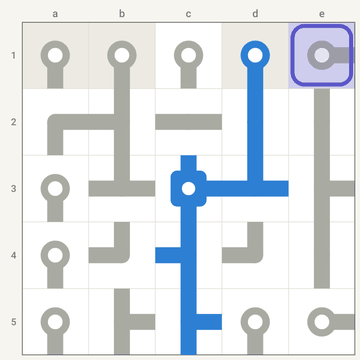 | **4. Match the ends** Pipes can't point off the board, and every end has to meet a pipe on the next tile. That leaves only one way for the dead end at e1: pointing down. |
| 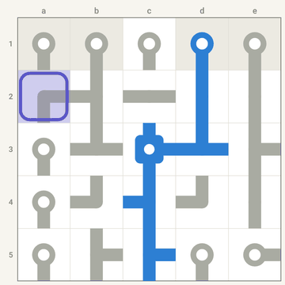 | **5. Match the ends** Pipes can't point off the board, and every end has to meet a pipe on the next tile. That leaves only one way for the corner at a2: joining up and right. |
| 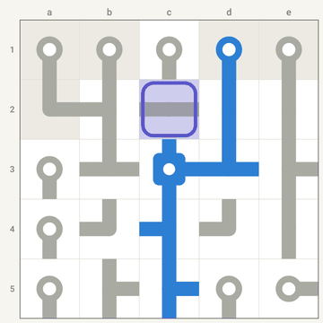 | **6. Match the ends** Its neighbours are settled enough that only one way lets every end meet a pipe: joining up and down. |
| 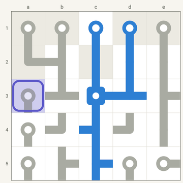 | **7. Match the ends** Pipes can't point off the board, and every end has to meet a pipe on the next tile. That leaves only one way for the dead end at a3: pointing right. |
| 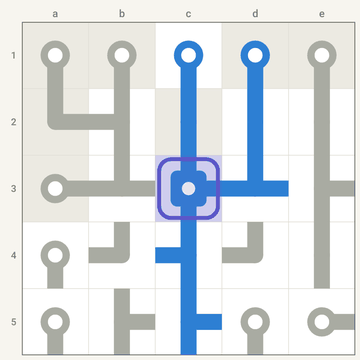 | **8. Match the ends** Its neighbours are settled enough that only one way lets every end meet a pipe: joining up, down and left. |
| 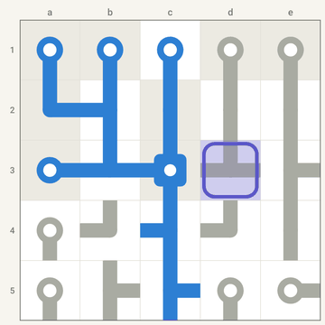 | **9. Match the ends** Its neighbours are settled enough that only one way lets every end meet a pipe: joining up, right and down. |
| 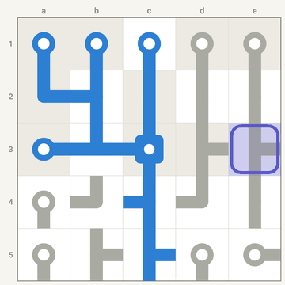 | **10. Match the ends** Pipes can't point off the board, and every end has to meet a pipe on the next tile. That leaves only one way for the T-junction at e3: joining up, down and left. |
| 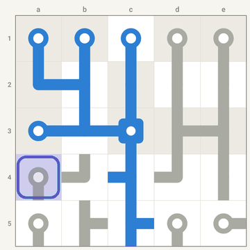 | **11. Match the ends** Pipes can't point off the board, and every end has to meet a pipe on the next tile. That leaves only one way for the dead end at a4: pointing right. |
| 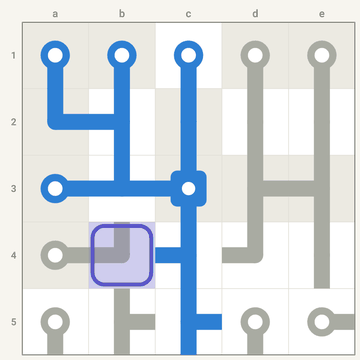 | **12. Match the ends** Its neighbours are settled enough that only one way lets every end meet a pipe: joining down and left. From here, the same techniques finish the puzzle. |
| 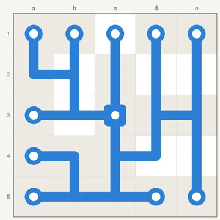 | **Solved!** Every rule is met. Now try a puzzle of your own. |

[← All puzzles](README.md) · [Using the app](../using-the-app.md)
