# Rectangles

*Split the grid into numbered rectangles*

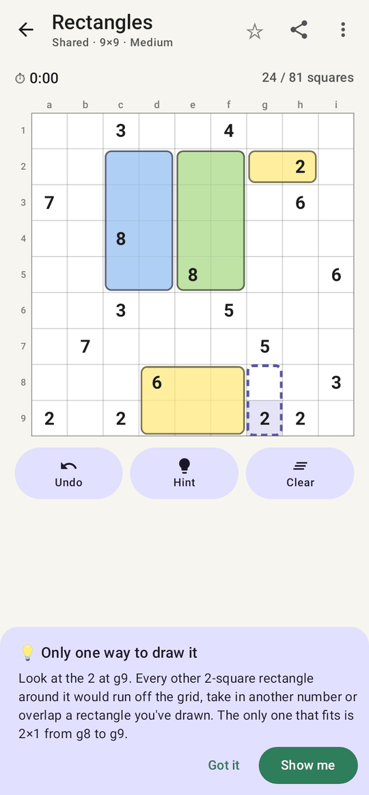

## Rules

- Divide the grid into rectangles (squares count too).

- Every rectangle contains exactly one number, and that number is its area — the count of squares inside it.

- Every square belongs to exactly one rectangle.

Drag from one corner to the opposite corner to draw a rectangle. Tap a rectangle to remove it.

## Sizes and difficulty

Board sizes: 6×6, 9×9, 12×12, 6×9, 9×13. Difficulty: Easy, Medium, Hard. The daily puzzle is small and easy early in the week and bigger and harder at the weekend.

## Learn to play

Tap 🎓 on the Rectangles menu for a short tutorial: these pages, then a guided puzzle where a coach shows every step.

**1. The goal.** Split the grid into rectangles. Each rectangle contains exactly one number, and that number is its area. Every square belongs to one rectangle.

**2. Drawing rectangles.** Drag from one corner to the opposite corner to draw a rectangle; tap one to remove it. Start with numbers that only have one possible shape, and squares only one number can reach. The highlighted area is the next step.

**3. Solved!.** The grid is fully divided and every rectangle matches its number. Now try it yourself.

## Walkthrough

The tutorial puzzle, solved step by step the way the in-app coach explains it. Each picture shows the board before the step, with the part of the board the step is about highlighted.

| Board | Step |
|---|---|
| 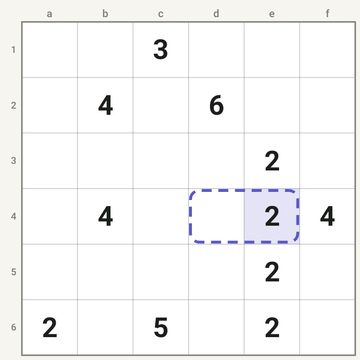 | **1. Only one way to draw it** Look at the 2 at e4. Every other 2-square rectangle around it would run off the grid or take in another number. The only one that fits is 1×2 from d4 to e4. |
| 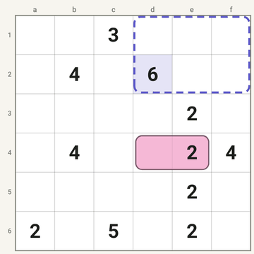 | **2. Only one way to draw it** Look at the 6 at d2. Every other 6-square rectangle around it would run off the grid, take in another number or overlap a rectangle you've drawn. The only one that fits is 2×3 from d1 to f2. |
| 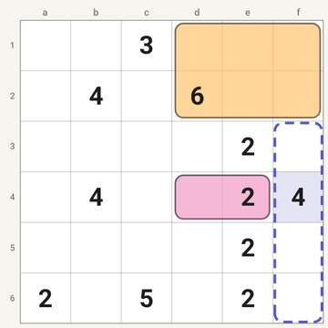 | **3. Only one way to draw it** Look at the 4 at f4. Every other 4-square rectangle around it would run off the grid, take in another number or overlap a rectangle you've drawn. The only one that fits is 4×1 from f3 to f6. |
| 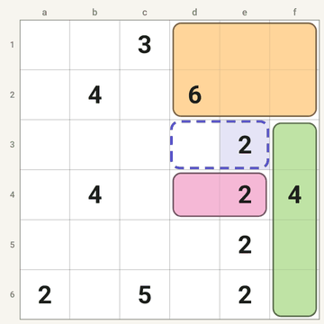 | **4. Only one way to draw it** Look at the 2 at e3. Every other 2-square rectangle around it would run off the grid, take in another number or overlap a rectangle you've drawn. The only one that fits is 1×2 from d3 to e3. |
| 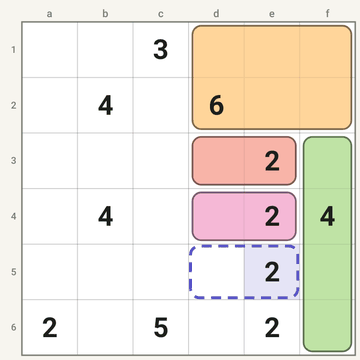 | **5. Only one way to draw it** Look at the 2 at e5. Every other 2-square rectangle around it would run off the grid, take in another number or overlap a rectangle you've drawn. The only one that fits is 1×2 from d5 to e5. |
| 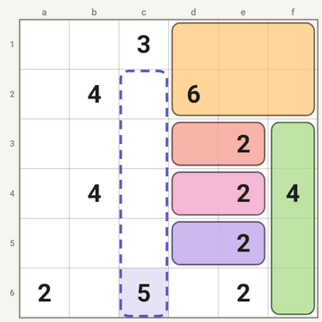 | **6. Only one way to draw it** Look at the 5 at c6. Every other 5-square rectangle around it would run off the grid, take in another number or overlap a rectangle you've drawn. The only one that fits is 5×1 from c2 to c6. |
| 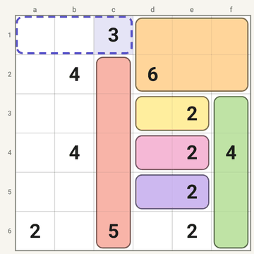 | **7. Only one way to draw it** Look at the 3 at c1. Every other 3-square rectangle around it would run off the grid, take in another number or overlap a rectangle you've drawn. The only one that fits is 1×3 from a1 to c1. |
| 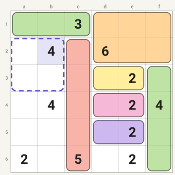 | **8. Only one way to draw it** Look at the 4 at b2. Every other 4-square rectangle around it would run off the grid, take in another number or overlap a rectangle you've drawn. The only one that fits is 2×2 from a2 to b3. |
| 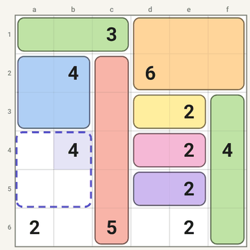 | **9. Only one way to draw it** Look at the 4 at b4. Every other 4-square rectangle around it would run off the grid, take in another number or overlap a rectangle you've drawn. The only one that fits is 2×2 from a4 to b5. |
| 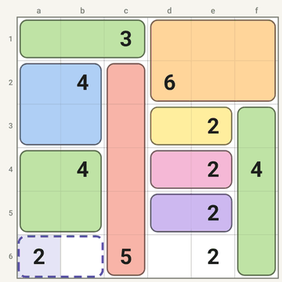 | **10. Only one way to draw it** Look at the 2 at a6. Every other 2-square rectangle around it would run off the grid, take in another number or overlap a rectangle you've drawn. The only one that fits is 1×2 from a6 to b6. |
| 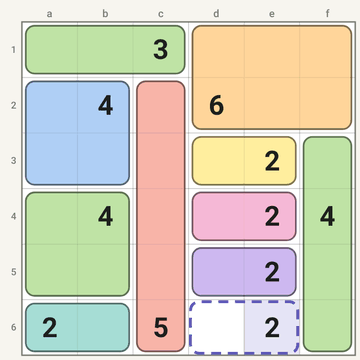 | **11. Only one way to draw it** Look at the 2 at e6. Every other 2-square rectangle around it would run off the grid, take in another number or overlap a rectangle you've drawn. The only one that fits is 1×2 from d6 to e6. |
| 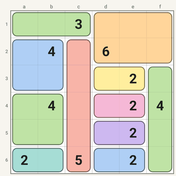 | **Solved!** Every rule is met. Now try a puzzle of your own. |

[← All puzzles](README.md) · [Using the app](../using-the-app.md)
