# Slitherlink

*Draw one loop around the numbers*

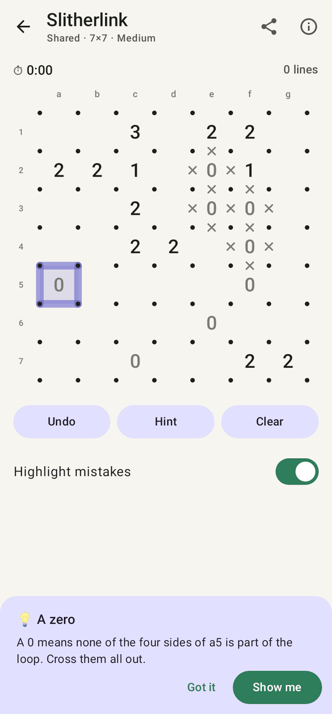

## Rules

- Draw a single closed loop along the dotted lines. It never crosses or branches.

- A number in a square tells you how many of its four sides the loop uses. Squares without numbers can have any number.

- The numbers don't have to be inside the loop. A number can end up inside, outside, or right on the edge of it — it only counts the sides of its own square that the line runs along. A 0 is often outside, and a 3 is usually where the loop turns around a corner.

When you finish, the inside of the loop is shaded so you can see which numbers ended up inside and outside.

Tap between two dots to draw a line, tap again to cross it out (definitely not used), and once more to clear it.

## Sizes and difficulty

Board sizes: 5×5, 7×7, 10×10. Difficulty: Easy, Medium, Hard. The daily puzzle is small and easy early in the week and bigger and harder at the weekend.

## Learn to play

Tap 🎓 on the Slitherlink menu for a short tutorial: these pages, then a guided puzzle where a coach shows every step.

**1. The goal.** Draw one closed loop along the dotted lines. A number tells you how many of its square's four sides the loop uses. Numbers can end up inside or outside the loop.

**2. Drawing the loop.** Tap between two dots to draw a line, again to cross it out. A 0 means none of its sides are used; the loop can't branch or stop, so a dot with one line must continue. The highlighted side is the next step.

**3. Solved!.** One loop, every number satisfied — the inside is shaded so you can see it. Your turn!

## Walkthrough

The tutorial puzzle, solved step by step the way the in-app coach explains it. Each picture shows the board before the step, with the part of the board the step is about highlighted.

| Board | Step |
|---|---|
| 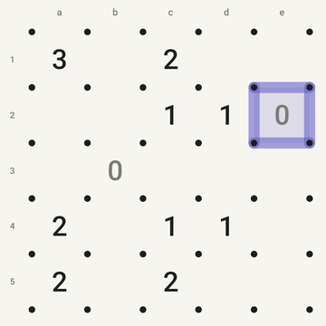 | **1. A zero** A 0 means none of the four sides of e2 is part of the loop. Cross them all out. |
| 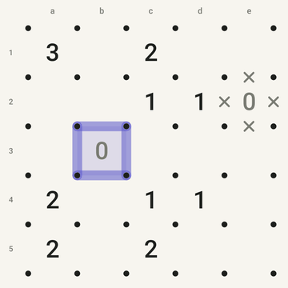 | **2. A zero** A 0 means none of the four sides of b3 is part of the loop. Cross them all out. |
| 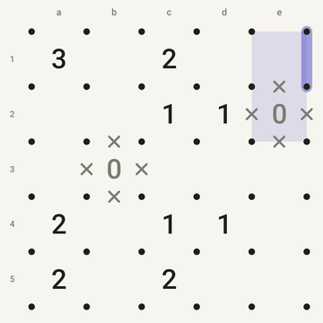 | **3. Dead end** Only one side at the top-right corner of e2 is still open. A line coming in would have nowhere to go, so that side is empty. |
| 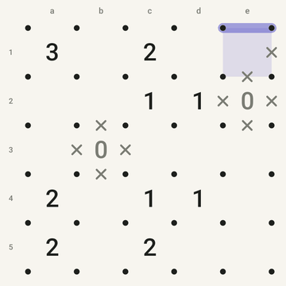 | **4. Dead end** Only one side at the top-right corner of e1 is still open. A line coming in would have nowhere to go, so that side is empty. |
| 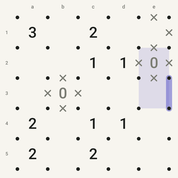 | **5. Dead end** Only one side at the top-right corner of e3 is still open. A line coming in would have nowhere to go, so that side is empty. |
| 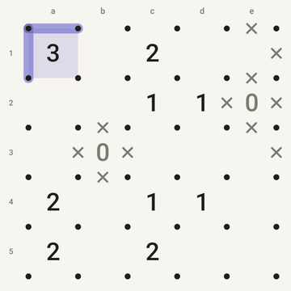 | **6. Turning a corner** At the top-left corner of a1 only two sides of a1 are left, so the loop either turns that corner (using both) or misses it. Without them the 3 couldn't get enough lines, so the loop turns the corner. |
| 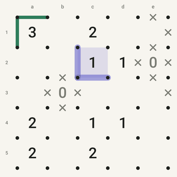 | **7. Turning a corner** At the top-left corner of c3 only two sides of c2 are left, so the loop either turns that corner (using both) or misses it. The 1 there can't take two more lines, so both sides are empty. |
| 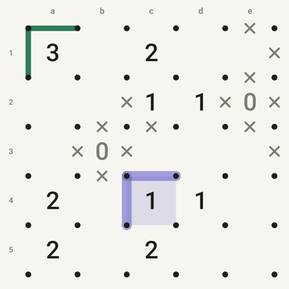 | **8. Turning a corner** At the top-left corner of c4 only two sides of c4 are left, so the loop either turns that corner (using both) or misses it. The 1 there can't take two more lines, so both sides are empty. |
| 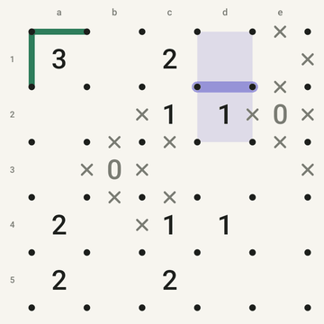 | **9. Try a what-if** Imagine drawing a line on the highlighted side. Following the rules from there (numbers, and two lines at every dot) quickly breaks something. So that side must be empty. |
| 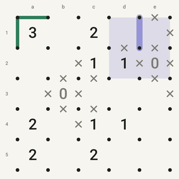 | **10. Dead end** Only one side at the top-left corner of e2 is still open. A line coming in would have nowhere to go, so that side is empty. |
| 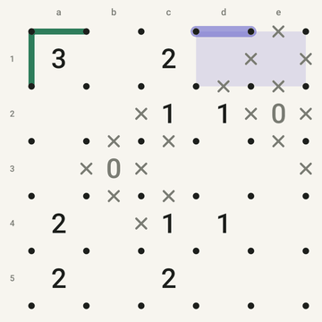 | **11. Dead end** Only one side at the top-left corner of e1 is still open. A line coming in would have nowhere to go, so that side is empty. |
| 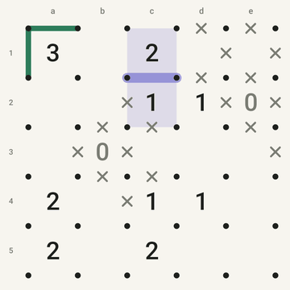 | **12. Try a what-if** Imagine drawing a line on the highlighted side. Following the rules from there (numbers, and two lines at every dot) quickly breaks something. So that side must be empty. From here, the same techniques finish the puzzle. |
| 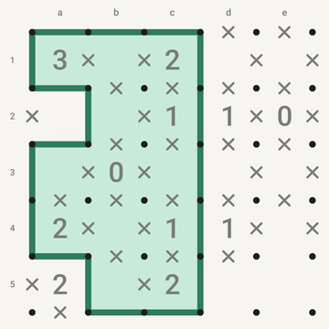 | **Solved!** Every rule is met. Now try a puzzle of your own. |

[← All puzzles](README.md) · [Using the app](../using-the-app.md)
