# Star Battle

*One star in every row, column and region*

## Rules

- Place one star in every row, every column and every coloured region.

- Stars can't touch each other — not even diagonally.

Tap a square once to mark it as empty (a dot), again for a star, and once more to clear it.

## Sizes and difficulty

Board sizes: 5×5, 6×6, 8×8, 10×10. Difficulty: Easy, Medium, Hard. The daily puzzle is small and easy early in the week and bigger and harder at the weekend.

## Learn to play

Tap 🎓 on the Star Battle menu for a short tutorial: these pages, then a guided puzzle where a coach shows every step.

**1. The goal.** Place one star in every row, every column and every coloured region. Stars can't touch each other, not even diagonally.

**2. Placing stars.** Tap a square once to mark it empty (a dot), twice for a star. Every star rules out its whole row, column, region and the squares around it — use Auto-dot to mark them. A region with one open square left must hold a star there, like the highlighted step.

**3. Solved!.** One star in every row, column and region, and none touching. Your turn!

## Walkthrough

The tutorial puzzle, solved step by step the way the in-app coach explains it. Each picture shows the board before the step, with the part of the board the step is about highlighted.

| Board | Step |
|---|---|
| 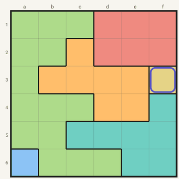 | **1. Only one place left** The yellow region needs a star and has only one square left that could hold it: f3. |
| 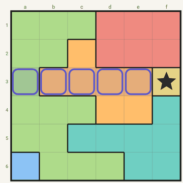 | **2. This one has its star** Row 3 already has its star, so none of its other squares can hold one. |
| 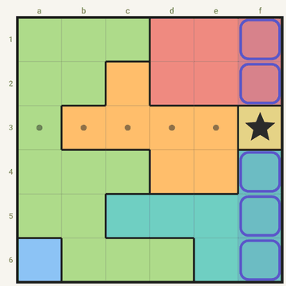 | **3. This one has its star** Column f already has its star, so none of its other squares can hold one. |
| 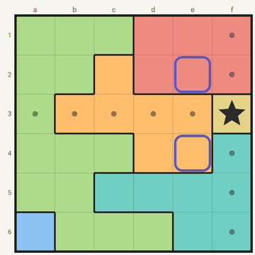 | **4. Give the star space** Stars can't touch, even diagonally, so every square around the star at f3 is empty. |
| 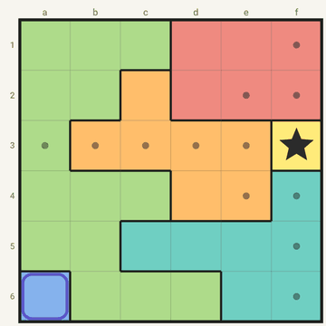 | **5. Only one place left** The blue region needs a star and has only one square left that could hold it: a6. |
| 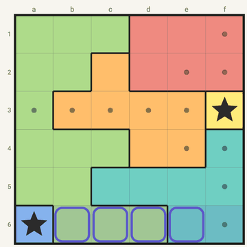 | **6. This one has its star** Row 6 already has its star, so none of its other squares can hold one. |
| 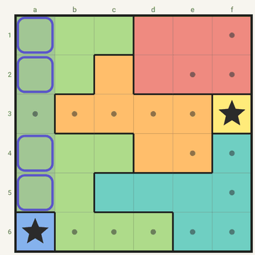 | **7. This one has its star** Column a already has its star, so none of its other squares can hold one. |
| 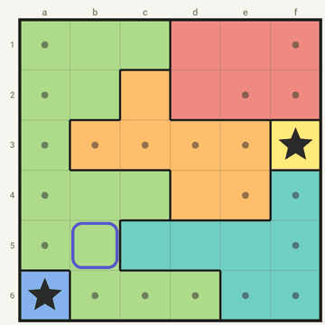 | **8. Give the star space** Stars can't touch, even diagonally, so every square around the star at a6 is empty. |
| 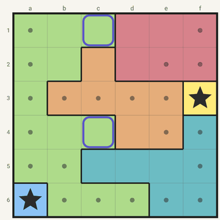 | **9. 3 into 3** The red region, the orange region and the teal region can only place their stars in column c, column d and column e. That's 3 stars for 3 columns, so those columns' stars all come from them — every other open square in column c, column d and column e is empty. |
| 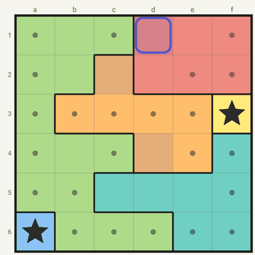 | **10. That would block the orange region** Imagine a star at d1. It would rule out every square still open in the orange region (they're all in its row, column, region or right next to it), leaving the orange region with no star. So d1 must be empty. |
| 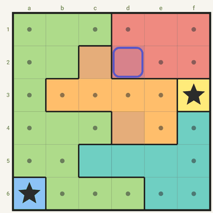 | **11. That would block the orange region** Imagine a star at d2. It would rule out every square still open in the orange region (they're all in its row, column, region or right next to it), leaving the orange region with no star. So d2 must be empty. |
| 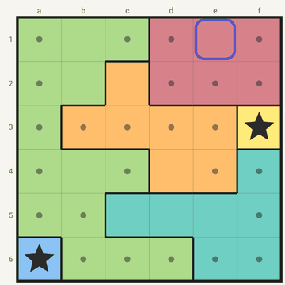 | **12. Only one place left** The red region needs a star and has only one square left that could hold it: e1. From here, the same techniques finish the puzzle. |
| 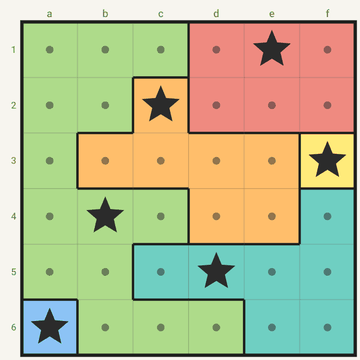 | **Solved!** Every rule is met. Now try a puzzle of your own. |

[← All puzzles](README.md) · [Using the app](../using-the-app.md)
