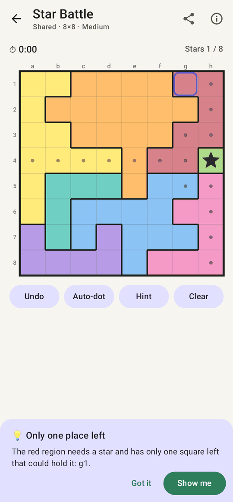

# Star Battle

*One star in every row, column and region*

## Rules

- Place one star in every row, every column and every coloured region.

- Stars can't touch each other — not even diagonally.

Tap a square once to mark it as empty (a dot), again for a star, and once more to clear it.

## Sizes and difficulty

Board sizes: 5×5, 6×6, 8×8, 10×10. Difficulty: Easy, Medium, Hard. The daily puzzle is small and easy early in the week and bigger and harder at the weekend.

## Learn to play

Tap 🎓 on the Star Battle menu for a short tutorial: these pages, then a guided puzzle where a coach shows every step.

**1. The goal.** Place one star in every row, every column and every coloured region. Stars can't touch each other, not even diagonally.

**2. Placing stars.** Tap a square once to mark it empty (a dot), twice for a star. Every star rules out its whole row, column, region and the squares around it — use Auto-dot to mark them. A region with one open square left must hold a star there, like the highlighted step.

**3. Solved!.** One star in every row, column and region, and none touching. Your turn!

[← All puzzles](README.md) · [Using the app](../using-the-app.md)
