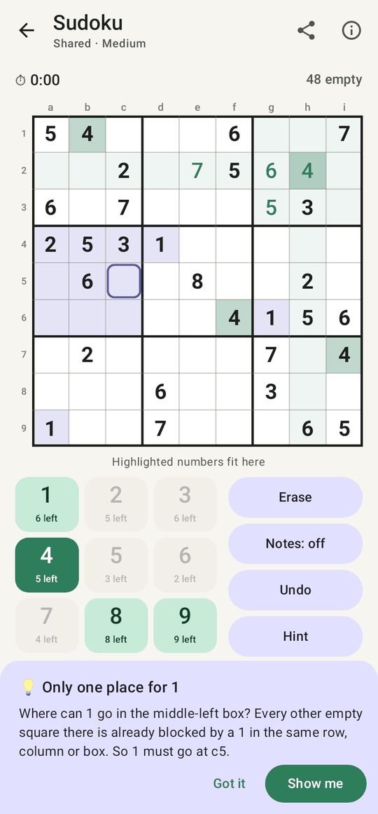

# Sudoku

*Classic 9×9 number placement*

## Rules

- Fill every row, column and 3×3 box with the digits 1 to 9.

- Each digit appears exactly once in every row, column and box.

Tap a square, then tap a number to fill it. Only the numbers not already in that square's row, column and box light up. Tap the same number again (or Erase) to clear the square, and turn on Notes to pencil in candidates. Clashing digits are shown in red.

## Sizes and difficulty

Board sizes: 9×9. Difficulty: Easy, Medium, Hard. The daily puzzle is small and easy early in the week and bigger and harder at the weekend.

## Learn to play

Tap 🎓 on the Sudoku menu for a short tutorial: these pages, then a guided puzzle where a coach shows every step.

**1. The goal.** Fill the grid so every row, every column and every 3×3 box contains each digit from 1 to 9 exactly once. The bold digits are given.

**2. Filling squares.** Tap a square, then tap a number. Only numbers that don't already appear in that square's row, column and box light up. Look for squares with only one possibility, or a digit that fits in only one place in a box — like the highlighted step.

**3. Solved!.** Every row, column and box has 1 to 9 once each. Now try it yourself, step by step.

[← All puzzles](README.md) · [Using the app](../using-the-app.md)
