# Sudoku

*Classic 9×9 number placement*

## Rules

- Fill every row, column and 3×3 box with the digits 1 to 9.

- Each digit appears exactly once in every row, column and box.

Tap a square, then tap a number to fill it. Only the numbers not already in that square's row, column and box light up. Tap the same number again (or Erase) to clear the square, and turn on Notes to pencil in candidates. Clashing digits are shown in red.

## Sizes and difficulty

Board sizes: 9×9. Difficulty: Easy, Medium, Hard. The daily puzzle is small and easy early in the week and bigger and harder at the weekend.

## Learn to play

Tap 🎓 on the Sudoku menu for a short tutorial: these pages, then a guided puzzle where a coach shows every step.

**1. The goal.** Fill the grid so every row, every column and every 3×3 box contains each digit from 1 to 9 exactly once. The bold digits are given.

**2. Filling squares.** Tap a square, then tap a number. Only numbers that don't already appear in that square's row, column and box light up. Look for squares with only one possibility, or a digit that fits in only one place in a box — like the highlighted step.

**3. Solved!.** Every row, column and box has 1 to 9 once each. Now try it yourself, step by step.

## Walkthrough

The tutorial puzzle, solved step by step the way the in-app coach explains it. Each picture shows the board before the step, with the part of the board the step is about highlighted.

| Board | Step |
|---|---|
| 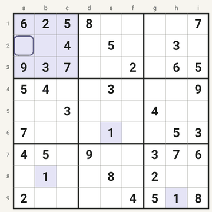 | **1. Only one place for 1** Where can 1 go in the top-left box? Every other empty square there is already blocked by a 1 in the same row, column or box. So 1 must go at a2. |
| 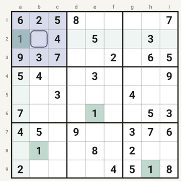 | **2. Last square in a group** The top-left box has only one empty square left. The only digit it's missing is 8. |
| 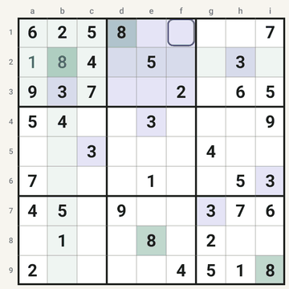 | **3. Only one place for 3** Where can 3 go in the top-middle box? Every other empty square there is already blocked by a 3 in the same row, column or box. So 3 must go at f1. |
| 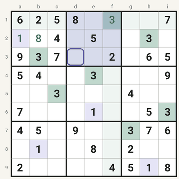 | **4. Only one place for 1** Where can 1 go in the top-middle box? Every other empty square there is already blocked by a 1 in the same row, column or box. So 1 must go at d3. |
| 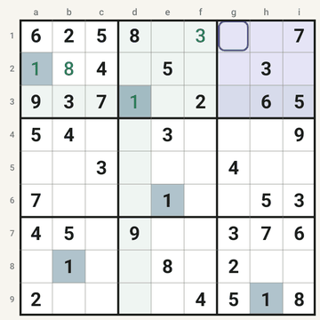 | **5. Only one place for 1** Where can 1 go in the top-right box? Every other empty square there is already blocked by a 1 in the same row, column or box. So 1 must go at g1. |
| 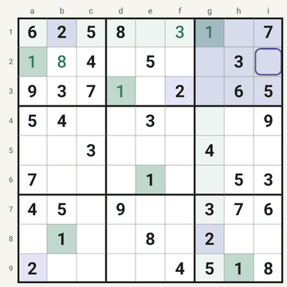 | **6. Only one place for 2** Where can 2 go in the top-right box? Every other empty square there is already blocked by a 2 in the same row, column or box. So 2 must go at i2. |
| 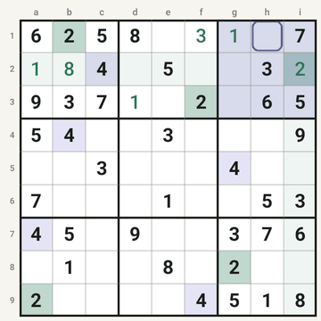 | **7. Only one place for 4** Where can 4 go in the top-right box? Every other empty square there is already blocked by a 4 in the same row, column or box. So 4 must go at h1. |
| 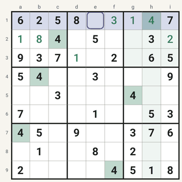 | **8. Last square in a group** Row 1 has only one empty square left. The only digit it's missing is 9. |
| 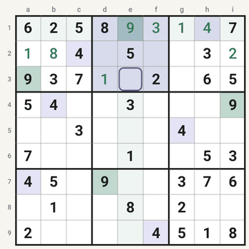 | **9. Only one place for 4** Where can 4 go in the top-middle box? Every other empty square there is already blocked by a 4 in the same row, column or box. So 4 must go at e3. |
| 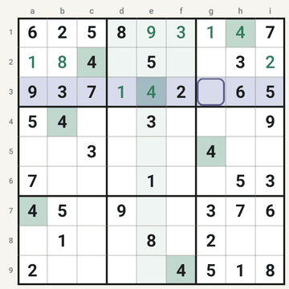 | **10. Last square in a group** Row 3 has only one empty square left. The only digit it's missing is 8. |
| 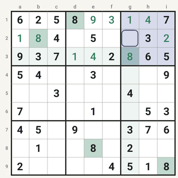 | **11. Last square in a group** The top-right box has only one empty square left. The only digit it's missing is 9. |
| 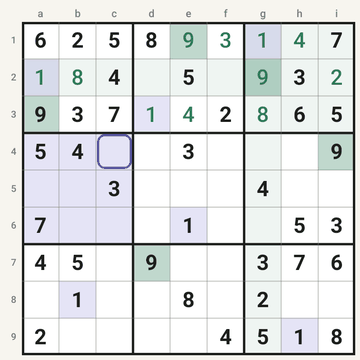 | **12. Only one place for 1** Where can 1 go in the middle-left box? Every other empty square there is already blocked by a 1 in the same row, column or box. So 1 must go at c4. From here, the same techniques finish the puzzle. |
| 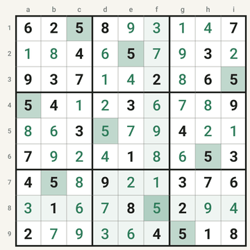 | **Solved!** Every rule is met. Now try a puzzle of your own. |

[← All puzzles](README.md) · [Using the app](../using-the-app.md)
