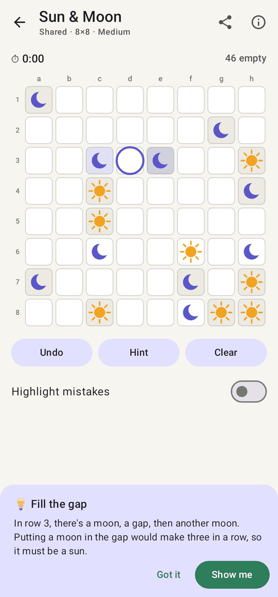

# Sun & Moon

*Balance suns and moons in every line*

## Rules

- Fill every square with a sun or a moon.

- No more than two of the same symbol may sit next to each other in a row or column.

- Every row and column contains the same number of suns and moons.

- No two rows are identical, and no two columns are identical.

Tap a square to cycle: sun → moon → blank. Turn on "Highlight mistakes" below the grid if you want rule breaks shown in red.

## Sizes and difficulty

Board sizes: 6×6, 8×8, 10×10. Difficulty: Easy, Medium, Hard. The daily puzzle is small and easy early in the week and bigger and harder at the weekend.

## Learn to play

Tap 🎓 on the Sun & Moon menu for a short tutorial: these pages, then a guided puzzle where a coach shows every step.

**1. The goal.** Fill every square with a sun or a moon. Each row and column has as many suns as moons, no more than two of the same symbol sit side by side, and no two rows (or columns) are identical.

**2. Placing symbols.** Tap a square to cycle sun → moon → blank. Two of a kind side by side must be closed off by the other symbol on both ends, and a gap between two of a kind takes the other symbol — like the highlighted step.

**3. Solved!.** Every line is balanced and no three alike touch. Try it yourself!

[← All puzzles](README.md) · [Using the app](../using-the-app.md)
