# Sun & Moon

*Balance suns and moons in every line*

## Rules

- Fill every square with a sun or a moon.

- No more than two of the same symbol may sit next to each other in a row or column.

- Every row and column contains the same number of suns and moons.

- No two rows are identical, and no two columns are identical.

Tap a square to cycle: sun → moon → blank. Turn on "Highlight mistakes" below the grid if you want rule breaks shown in red.

## Sizes and difficulty

Board sizes: 6×6, 8×8, 10×10, 6×8, 8×12. Difficulty: Easy, Medium, Hard. The daily puzzle is small and easy early in the week and bigger and harder at the weekend.

## Learn to play

Tap 🎓 on the Sun & Moon menu for a short tutorial: these pages, then a guided puzzle where a coach shows every step.

**1. The goal.** Fill every square with a sun or a moon. Each row and column has as many suns as moons, no more than two of the same symbol sit side by side, and no two rows (or columns) are identical.

**2. Placing symbols.** Tap a square to cycle sun → moon → blank. Two of a kind side by side must be closed off by the other symbol on both ends, and a gap between two of a kind takes the other symbol — like the highlighted step.

**3. Solved!.** Every line is balanced and no three alike touch. Try it yourself!

## Walkthrough

The tutorial puzzle, solved step by step the way the in-app coach explains it. Each picture shows the board before the step, with the part of the board the step is about highlighted.

| Board | Step |
|---|---|
| 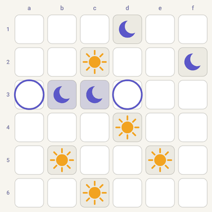 | **1. Two alike side by side** In row 3, two moons sit next to each other. A third moon beside them would make three in a row, so the squares on either side must be suns. |
| 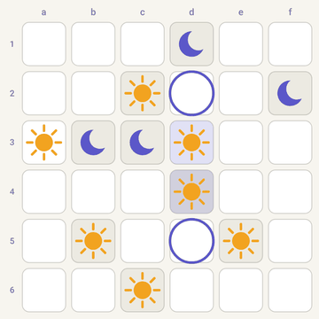 | **2. Two alike side by side** In column d, two suns sit next to each other. A third sun beside them would make three in a row, so the squares on either side must be moons. |
| 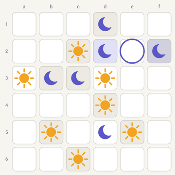 | **3. Fill the gap** In row 2, there's a moon, a gap, then another moon. Putting a moon in the gap would make three in a row, so it must be a sun. |
| 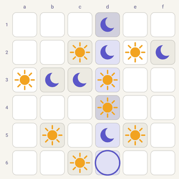 | **4. Count the moons** Column d already has all 3 of its moons, so every empty square left in it is a sun. |
| 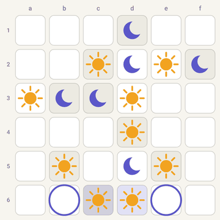 | **5. Two alike side by side** In row 6, two suns sit next to each other. A third sun beside them would make three in a row, so the squares on either side must be moons. |
| 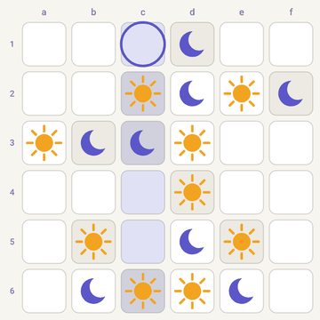 | **6. Try every way to finish the line** Imagine every way to complete column c with 3 suns and 3 moons, no three alike in a row, and not copying another finished line. Every one of them puts a moon at c1. |
| 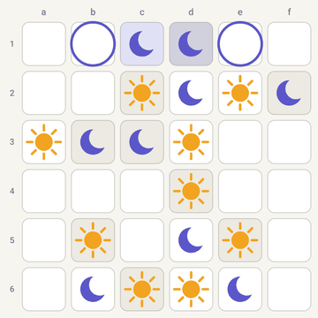 | **7. Two alike side by side** In row 1, two moons sit next to each other. A third moon beside them would make three in a row, so the squares on either side must be suns. |
| 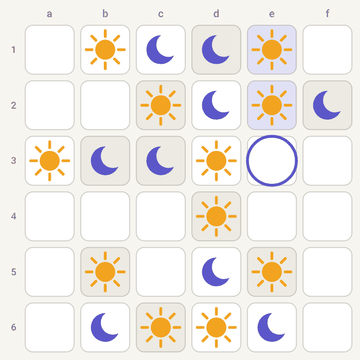 | **8. Two alike side by side** In column e, two suns sit next to each other. A third sun beside them would make three in a row, so the square beside them must be a moon. |
| 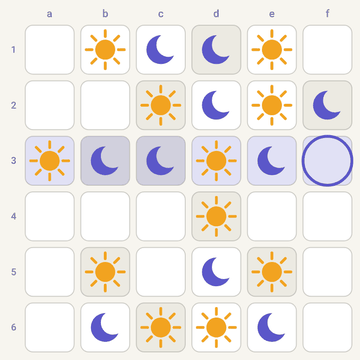 | **9. Count the moons** Row 3 already has all 3 of its moons, so every empty square left in it is a sun. |
| 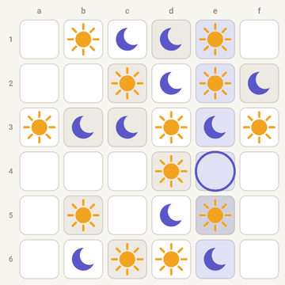 | **10. Count the suns** Column e already has all 3 of its suns, so every empty square left in it is a moon. |
| 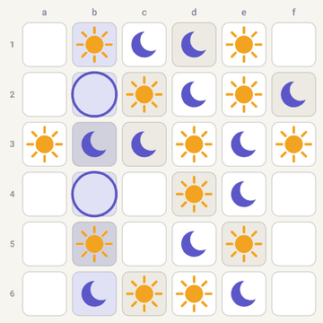 | **11. Try every way to finish the line** Imagine every way to complete column b with 3 suns and 3 moons, no three alike in a row, and not copying another finished line. Every one of them puts a moon at b2 and a sun at b4. |
| 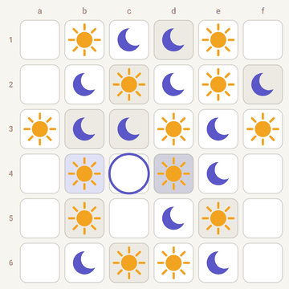 | **12. Fill the gap** In row 4, there's a sun, a gap, then another sun. Putting a sun in the gap would make three in a row, so it must be a moon. From here, the same techniques finish the puzzle. |
| 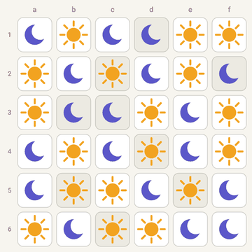 | **Solved!** Every rule is met. Now try a puzzle of your own. |

[← All puzzles](README.md) · [Using the app](../using-the-app.md)
