# Towers

*Build towers so the edge counts add up*

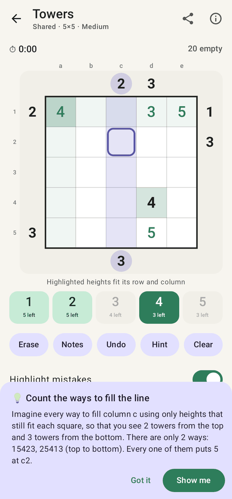

## Rules

- Fill every square with a tower from 1 (shortest) to the size of the grid (tallest).

- Every row and every column holds each height exactly once.

- A number outside the grid says how many towers you can see from there, looking along that row or column. Taller towers hide the shorter ones behind them, so a 1 means the tallest tower stands right at the edge.

- Edges without a number can show any count. Some puzzles start with a few towers already built.

Tap a square, then tap a height on the number pad. Tap the same height again (or Erase) to clear the square, and turn on Notes to pencil in possible heights. Clashing heights turn red, and an edge number dims once its line is done right (or turns red if it's wrong).

## Sizes and difficulty

Board sizes: 4×4, 5×5, 6×6, 7×7. Difficulty: Easy, Medium, Hard. The daily puzzle is small and easy early in the week and bigger and harder at the weekend.

## Learn to play

Tap 🎓 on the Towers menu for a short tutorial: these pages, then a guided puzzle where a coach shows every step.

**1. The goal.** Fill the grid with towers so every row and column has each height once. The numbers around the edge say how many towers you can see from there — tall towers hide the shorter ones behind them.

**2. Building towers.** Tap a square, then tap a height. A 1 on the edge means the tallest tower is right next to it, and a big number keeps tall towers away from that edge. A height that fits in only one square of a row or column goes there — like the highlighted step.

**3. Solved!.** Every row and column has each height once, and every edge number counts right. Now build one yourself — the coach will guide you step by step.

## Walkthrough

The tutorial puzzle, solved step by step the way the in-app coach explains it. Each picture shows the board before the step, with the part of the board the step is about highlighted.

| Board | Step |
|---|---|
| 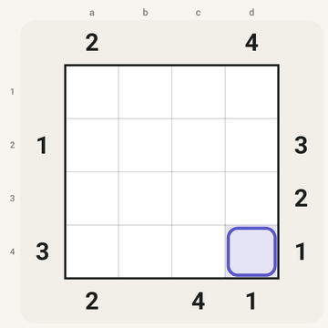 | **1. A 1 sees only the tallest** The 1 below column d means you can see only one tower from the bottom. That only works if the tallest tower, 4, stands right at the edge and hides all the others. So d4 is 4. |
| 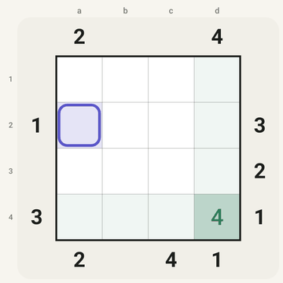 | **2. A 1 sees only the tallest** The 1 left of row 2 means you can see only one tower from the left. That only works if the tallest tower, 4, stands right at the edge and hides all the others. So a2 is 4. |
| 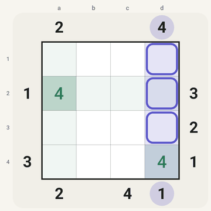 | **3. Every tower in view** The 4 above column d means you can see all 4 towers from the top. No tower may hide another, so they must rise one step at a time: 1, 2, 3, 4. |
| 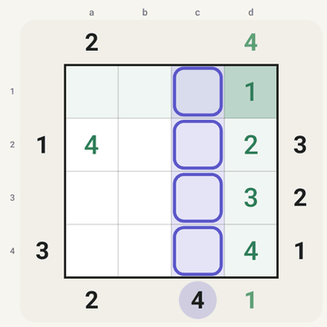 | **4. Every tower in view** The 4 below column c means you can see all 4 towers from the bottom. No tower may hide another, so they must rise one step at a time: 1, 2, 3, 4. |
| 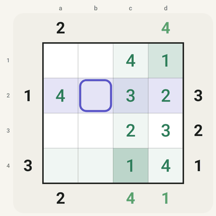 | **5. Last square in the line** Row 2 has only one empty square left. The only height it's missing is 1. |
| 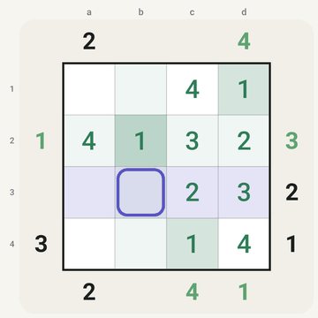 | **6. Only one place for 4** Where can the 4 go in row 3? The other empty squares are ruled out — a3: column a already has a 4. So the 4 must go at b3. |
| 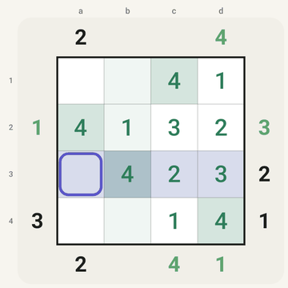 | **7. Last square in the line** Row 3 has only one empty square left. The only height it's missing is 1. |
| 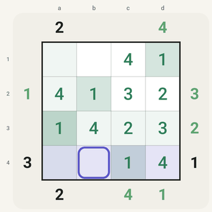 | **8. Only one place for 3** Where can the 3 go in row 4? The other empty squares are ruled out — a4: it's right next to the 3 left of row 4, so it can be at most 2 (a taller tower there would hide too many to leave 3 in view). So the 3 must go at b4. |
| 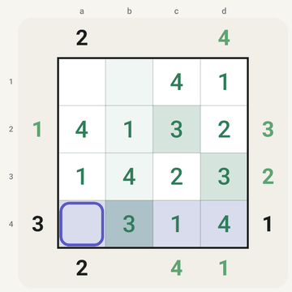 | **9. Last square in the line** Row 4 has only one empty square left. The only height it's missing is 2. |
| 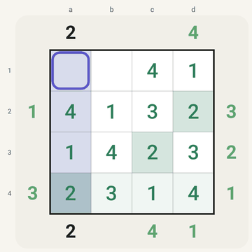 | **10. Last square in the line** Column a has only one empty square left. The only height it's missing is 3. |
| 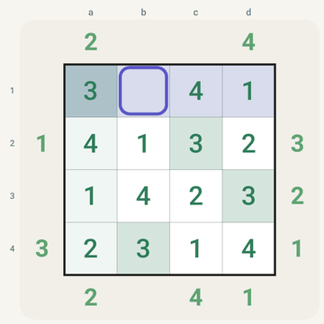 | **11. Last square in the line** Row 1 has only one empty square left. The only height it's missing is 2. |
| 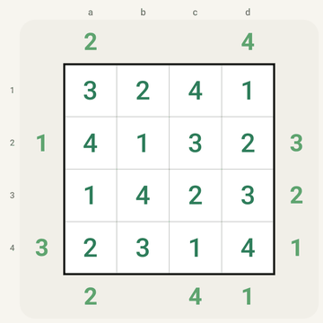 | **Solved!** Every rule is met. Now try a puzzle of your own. |

[← All puzzles](README.md) · [Using the app](../using-the-app.md)
