# Trail

*One path through every square, in order*

## Rules

- Draw a single path that starts at 1 and visits the numbers in order, ending on the highest number.

- The path must fill every square exactly once. It can't cross itself or pass through the thick walls.

Drag from 1 to draw. Drag back along the path to undo steps, or touch any square on the path to continue from there.

## Sizes and difficulty

Board sizes: 5×5, 6×6, 7×7, 8×8, 5×7, 6×9. Difficulty: Easy, Medium, Hard. The daily puzzle is small and easy early in the week and bigger and harder at the weekend.

## Learn to play

Tap 🎓 on the Trail menu for a short tutorial: these pages, then a guided puzzle where a coach shows every step.

**1. The goal.** Draw one path that starts at 1, visits the numbers in order and ends on the highest number, filling every square exactly once. Thick walls block the way.

**2. Drawing the path.** Drag from 1 to draw; drag back to undo steps. Watch out for squares that would be cut off or left with only one way in. The highlighted squares are the next step.

**3. Solved!.** Every square visited, numbers in order. Now draw it yourself.

## Walkthrough

The tutorial puzzle, solved step by step the way the in-app coach explains it. Each picture shows the board before the step, with the part of the board the step is about highlighted.

| Board | Step |
|---|---|
| 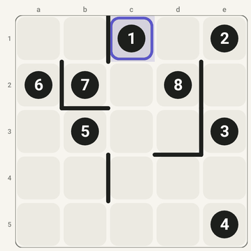 | **1. Start at 1** Every trail starts on the square marked 1, at c1. Drag from there to draw your path. |
| 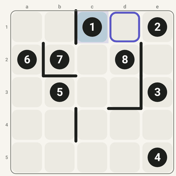 | **2. Count the links** From c1 you could go to c2 or d1. Going to c2 doesn't work: count the ways in and out of each empty square — squares with only two neighbours left must use both. Following those forced links, b2 would not have enough ways in and out. So the trail continues to d1. |
| 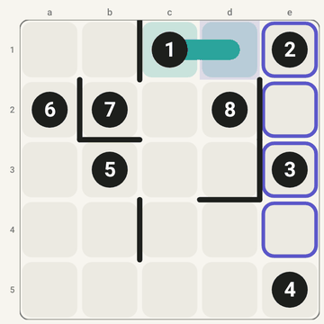 | **3. Numbers in order** From d1 you could go to d2 or e1. Going to d2 doesn't work: d2 is number 8, but the next number needed is 2. So the trail continues to e1. From there, the next 3 squares are forced too. |
| 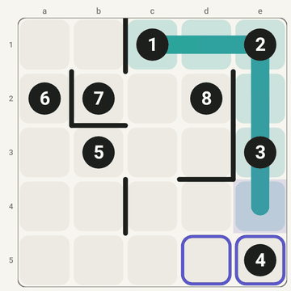 | **4. Avoid dead ends** From e4 you could go to e5 or d4. Going to d4 doesn't work: e5 would be left with only one way in, so the trail would get stuck there. So the trail continues to e5. From there, the next square is forced too. |
| 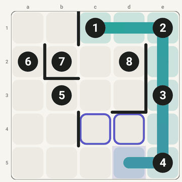 | **5. Avoid dead ends** From d5 you could go to d4 or c5. Going to c5 doesn't work: d4 would be left with only one way in, so the trail would get stuck there. So the trail continues to d4. From there, the next square is forced too. |
| 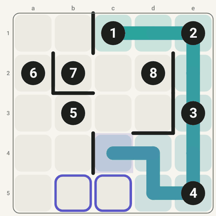 | **6. Avoid dead ends** From c4 you could go to c3 or c5. Going to c3 doesn't work: c5 would be left with only one way in, so the trail would get stuck there. So the trail continues to c5. From there, the next square is forced too. |
| 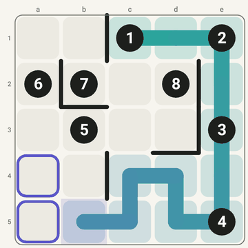 | **7. Avoid dead ends** From b5 you could go to b4 or a5. Going to b4 doesn't work: a5 would be left with only one way in, so the trail would get stuck there. So the trail continues to a5. From there, the next square is forced too. |
| 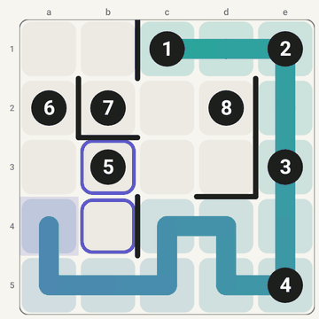 | **8. Avoid dead ends** From a4 you could go to a3 or b4. Going to a3 doesn't work: b4 would be left with only one way in, so the trail would get stuck there. So the trail continues to b4. From there, the next square is forced too. |
| 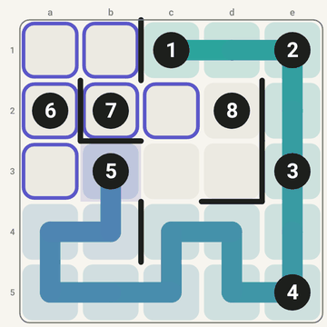 | **9. Avoid dead ends** From b3 you could go to a3 or c3. Going to c3 doesn't work: a3 would be left with only one way in, so the trail would get stuck there. So the trail continues to a3. From there, the next 5 squares are forced too. |
| 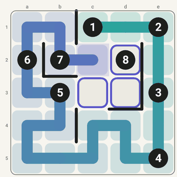 | **10. Numbers in order** From c2 you could go to c3 or d2. Going to d2 doesn't work: d2 is the last number, so the trail would end before filling every square. So the trail continues to c3. From there, the next 2 squares are forced too. |
| 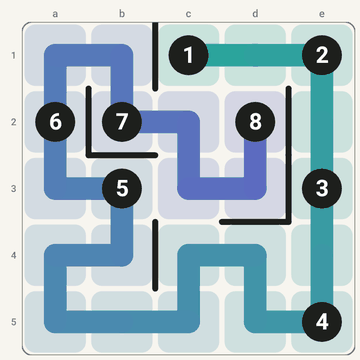 | **Solved!** Every rule is met. Now try a puzzle of your own. |

[← All puzzles](README.md) · [Using the app](../using-the-app.md)
