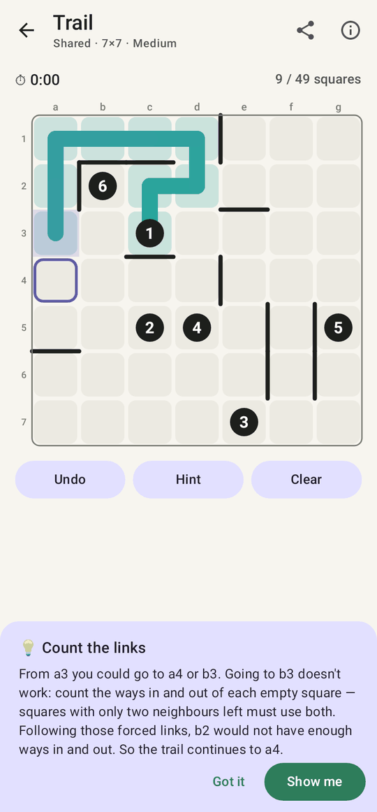

# Trail

*One path through every square, in order*

## Rules

- Draw a single path that starts at 1 and visits the numbers in order, ending on the highest number.

- The path must fill every square exactly once. It can't cross itself or pass through the thick walls.

Drag from 1 to draw. Drag back along the path to undo steps, or touch any square on the path to continue from there.

## Sizes and difficulty

Board sizes: 5×5, 6×6, 7×7, 8×8. Difficulty: Easy, Medium, Hard. The daily puzzle is small and easy early in the week and bigger and harder at the weekend.

## Learn to play

Tap 🎓 on the Trail menu for a short tutorial: these pages, then a guided puzzle where a coach shows every step.

**1. The goal.** Draw one path that starts at 1, visits the numbers in order and ends on the highest number, filling every square exactly once. Thick walls block the way.

**2. Drawing the path.** Drag from 1 to draw; drag back to undo steps. Watch out for squares that would be cut off or left with only one way in. The highlighted squares are the next step.

**3. Solved!.** Every square visited, numbers in order. Now draw it yourself.

[← All puzzles](README.md) · [Using the app](../using-the-app.md)
