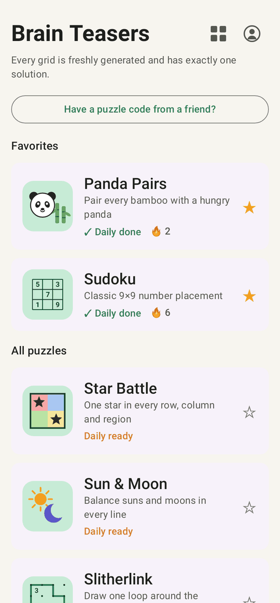
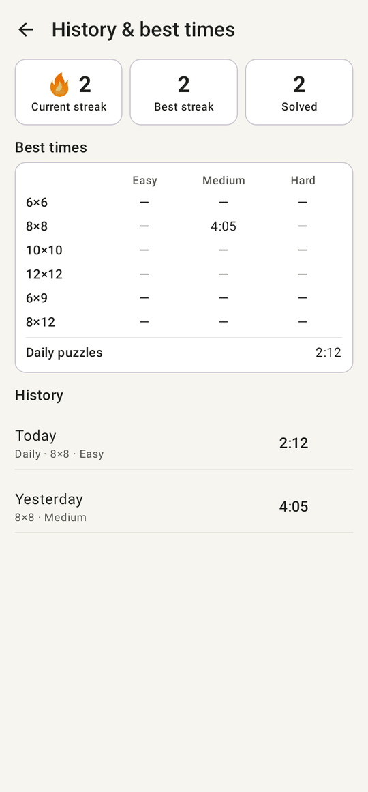
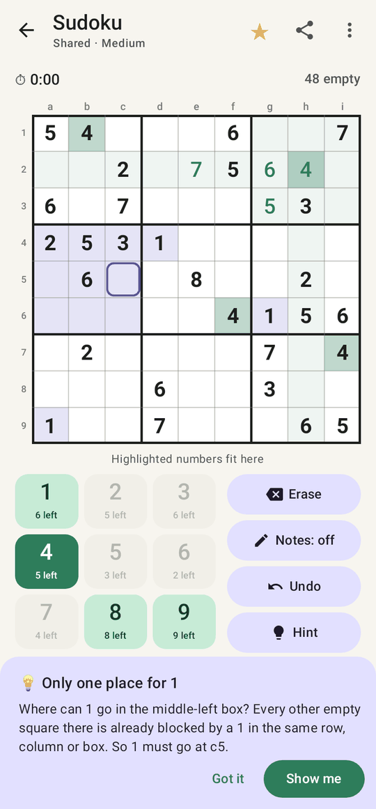
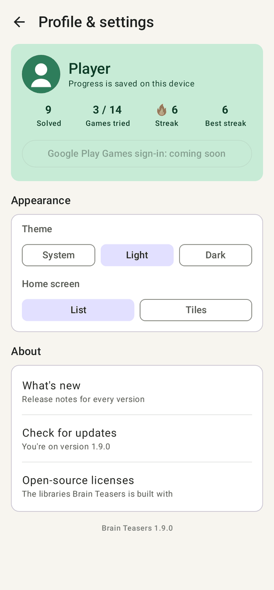
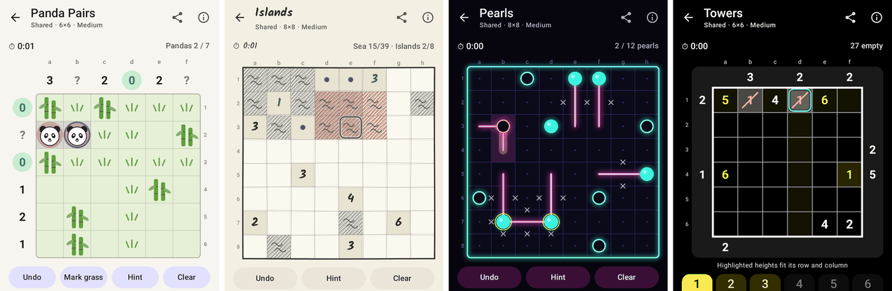

# Using the app

## The home screen

 

Every puzzle is listed with its daily-puzzle status, your streak and how many of its levels you've
unlocked (see [Unlocking levels](#unlocking-levels)). Tap ☆ to make a puzzle a
favourite (the same star is on each puzzle's menu and at the top of its play screen): favourites are listed first. The button next to the profile icon switches between a list and
big tiles.

**Have a puzzle code from a friend?** opens a puzzle someone shared with you (see [Sharing](#sharing)).

**Continue** lists puzzles you started but haven't finished, with your time so far: tap one to carry on
exactly where you left off. Tap ✕ to drop one, or **Clear all** to drop them all. Each puzzle keeps one
unfinished daily, one new and one shared puzzle; solving it removes it from the list.

## A puzzle's menu

Tap a puzzle to see:

- **Today's puzzle:** everyone gets the same daily puzzle. It's small and easy early in the week and
  bigger and harder at the weekend. Solve at least one puzzle of a game each day to keep its 🔥 streak.
- **New puzzle:** choose a board **size** and a **difficulty** (Easy, Medium or Hard; Link Up also has
  Expert), then **Play**. Your choice is remembered. Harder doesn't just mean bigger: hard puzzles need
  deeper reasoning, while easy ones can be solved one simple step at a time. Many puzzles come in
  phone-shaped sizes too (like 7×11), which fill the screen better than square boards. Sizes are listed
  from smallest to largest; locked ones are greyed out with a 🔒, and the line under Play says what opens next.
- **Highlight mistakes:** whether this puzzle marks broken rules in red (also in the ⋮ menu while you play).
- **History & best times:** your best time for every size and difficulty, and every puzzle you've solved.
- **🎓** at the top opens the tutorial, and **ⓘ** shows the rules.

### Unlocking levels

Each puzzle starts with its smallest Easy board. Solve 3 puzzles at a level to open the next difficulty
at that size and the next size up at that difficulty. Locked sizes and difficulties are greyed out.
Every solve counts at its own level, daily puzzles and puzzles from friends included: a solve at a level
that's still locked is kept for when the path gets there. Levels you'd played before unlocks arrived
stay open. When a solve opens something new, the
finishing screen offers to play it straight away. Daily and shared puzzles can always be played. Rather
skip it? **Unlock every size and difficulty** in Profile & settings opens everything.

## Playing

The timer runs while you play and pauses when you leave the app. Most puzzles mark broken rules in red
(two equal numbers in a row, an over-full clue, a 2×2 pool…); turn **Highlight mistakes** off in the ⋮
puzzle menu (or on the puzzle's menu) if you'd rather find them yourself. It's remembered for each puzzle.
The ⋮ menu also has **How to play**. **Undo** takes back your last move.
Letters along the top and numbers down the side name every square, like a chessboard: hints say things
like "the 2 at h6".

**Zoom:** pinch with two fingers to zoom in on any board, and drag with two fingers to move around (one
finger still plays). **Reset zoom** above the board goes back to the whole puzzle. On big Minesweeper
boards one finger drags the board, and pinching or the − / + buttons change the size.

When you finish, you'll see your time, your best time at that size and difficulty, and your streak.
The ↻ button at the top starts a new puzzle with the same settings.

## Hints

Stuck? Tap **Hint**. Hints don't just reveal an answer: they explain the next logical step, highlight the
squares involved, and offer **Show me** to make the move for you. If you've made a mistake, the hint
points it out first.

Daily puzzles have no hints: everyone's daily time is their own. After you use a hint, the Hint button
recharges for 10 seconds (it shows a countdown). Solves that used
hints are marked "with hints" and don't count for best times.

In Minesweeper, if you open a mine, the game shows the step the numbers offered instead.
**Take it back & show me** undoes the move and highlights that step on the board.

## Tutorials

Each puzzle has a two-minute tutorial: a few illustrated pages, then a guided puzzle where a coach shows
every step. Start it with **🎓** on the puzzle's menu (new players also see a "New here?" suggestion).
You can leave a tutorial at any time and come back later. Tutorials don't affect your streaks or history.

## Sharing

Tap the share button while playing to send the puzzle to a friend. After you solve one, you can share it
with your time as a challenge to beat. You can also share any puzzle from **History & best times** on a puzzle's menu: tap the share button next
to it (puzzles solved before version 1.9.0 don't have one). Your friend opens the link or types the code (like `PND2v3-H4F9K2Q7A`)
under **Have a puzzle code from a friend?** on the home screen, and gets exactly the same puzzle.

Codes made by a newer version of the app ask you to update first, so you never get a different puzzle by
mistake.

## Profile and settings

The profile button at the top right of the home screen shows your overall stats, and lets you choose:

- **Look:** ten themes. Each one restyles every board and the puzzle icons:
  - **Classic**: the original look
  - **Pencil**: graphite on paper, like the puzzle books
  - **Neon**: glowing lines on a midnight board
  - **High contrast**: bold and colour-blind friendly
  - **Blueprint**: white technical lines on blueprint blue (blue on white in light mode)
  - **Origami**: folded paper squares; pieces lift off the page
  - **Chalkboard**: chalk on a slate-green board
  - **Retro pixel**: chunky pixels and an 8-bit palette
  - **Paper cut**: layers of cut paper with soft shadows
  - **Watercolour**: soft washes of paint on textured paper
- **Light or dark:** System, Light or Dark (Neon and Chalkboard are always dark, Watercolour always light). You can also change the theme and light or dark without leaving a puzzle: tap the palette button on the home screen or a puzzle's menu, or ⋮ → **Appearance** while playing.
- **Puzzles:** **Unlock every size and difficulty** skips the unlock path
- **Home screen:** list or tiles

- **What's new**, **Check for updates** and **Open-source licenses**

On a tablet or an open foldable turned sideways, the board sits on the left with the buttons (and any hint) beside it, and each puzzle's menu shows its rules next to the play options.

Google Play Games sign-in (achievements, leaderboards and saving across devices) is planned.

[← User guide](README.md)
