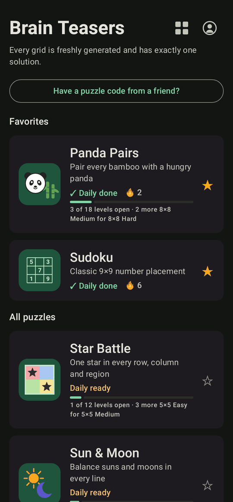
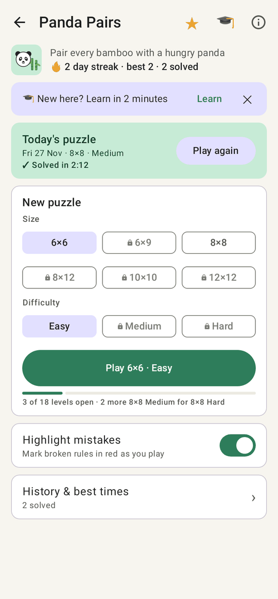

# Using the app

## The home screen

 

Every puzzle is listed with its daily-puzzle status and your streak. Tap ☆ to make a puzzle a
favourite: favourites are listed first. The button next to the profile icon switches between a list and
big tiles.

**Have a puzzle code from a friend?** opens a puzzle someone shared with you (see [Sharing](#sharing)).

## A puzzle's menu

Tap a puzzle to see:

- **Today's puzzle:** everyone gets the same daily puzzle. It's small and easy early in the week and
  bigger and harder at the weekend. Solve at least one puzzle of a game each day to keep its 🔥 streak.
- **New puzzle:** choose a board **size** and a **difficulty** (Easy, Medium or Hard; Link Up also has
  Expert), then **Play**. Your choice is remembered. Harder doesn't just mean bigger: hard puzzles need
  deeper reasoning, while easy ones can be solved one simple step at a time.
- **History & best times:** your best time for every size and difficulty, and every puzzle you've solved.
- **🎓** at the top opens the tutorial, and **ⓘ** shows the rules.

## Playing

The timer runs while you play and pauses when you leave the app. **Undo** takes back your last move.
Letters along the top and numbers down the side name every square, like a chessboard: hints say things
like "the 2 at h6".

When you finish, you'll see your time, your best time at that size and difficulty, and your streak.
The ↻ button at the top starts a new puzzle with the same settings.

## Hints

Stuck? Tap **Hint**. Hints don't just reveal an answer: they explain the next logical step, highlight the
squares involved, and offer **Show me** to make the move for you. If you've made a mistake, the hint
points it out first.

After you use a hint, the Hint button recharges for 10 seconds (it shows a countdown). Solves that used
hints are marked "with hints" and don't count for best times.

In Minesweeper, if you open a mine, the game shows the step the numbers offered instead.
**Take it back & show me** undoes the move and highlights that step on the board.

## Tutorials

Each puzzle has a two-minute tutorial: a few illustrated pages, then a guided puzzle where a coach shows
every step. Start it with **🎓** on the puzzle's menu (new players also see a "New here?" suggestion).
You can leave a tutorial at any time and come back later. Tutorials don't affect your streaks or history.

## Sharing

Tap the share button while playing to send the puzzle to a friend. After you solve one, you can share it
with your time as a challenge to beat. Your friend opens the link or types the code (like `PND2v3-H4F9K2Q7A`)
under **Have a puzzle code from a friend?** on the home screen, and gets exactly the same puzzle.

Codes made by a newer version of the app ask you to update first, so you never get a different puzzle by
mistake.

## Profile and settings

The profile button at the top right of the home screen shows your overall stats, and lets you choose:

- **Theme:** System, Light or Dark
- **Home screen:** list or tiles
- **What's new**, **Check for updates** and **Open-source licenses**

Google Play Games sign-in (achievements, leaderboards and saving across devices) is planned.

[← User guide](README.md)
